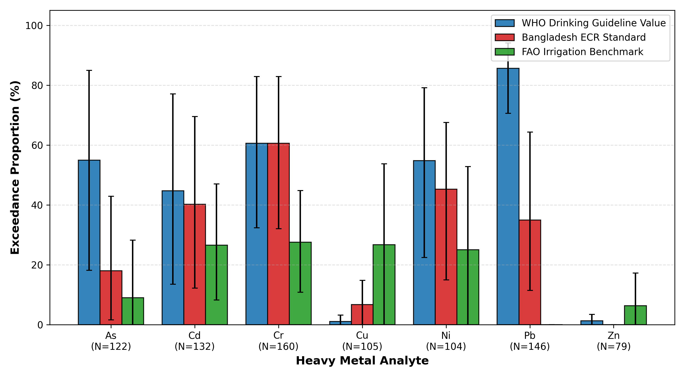

# Heavy Metals in Bangladesh River Waters: A Synthesis of Published Records (2010--2024), Benchmark Exceedances, Seasonal Contrasts, and River Network Coverage

**Target Journal:** *Chemosphere* (Elsevier)  
**Article Type:** Original Research Paper  
**Status:** Post-Round 2 Peer Review Audit Revision  

---

## Abstract
River water in the Bengal Delta provides indispensable freshwater for regional ecology, agriculture, and municipal water abstraction, but fluvial corridors receive substantial industrial and municipal effluent loadings. Here, we present a synthesis of published heavy metal records in Bangladesh river waters by auditing 268 surface water observations (162 trace element records across 12 peer-reviewed field investigations published between 2010 and 2024; 106 general physicochemical records across 5 studies). Concentrations were screened against international health benchmarks (WHO Guidelines for Drinking-water Quality, 4th ed. incorporating 2022 addenda), statutory domestic standards (Bangladesh Environmental Conservation Rules, ECR 1997/2023 potable schedules), and agricultural guidelines (FAO Irrigation and Drainage Paper 29). Accounting for intra-study correlation through 5,000-resample study-level cluster bootstrapping, substantial benchmark exceedances were documented in the compiled literature: Lead (Pb) exceeded the WHO guideline (0.010 mg/L) in **85.6%** of records (study-level cluster 95% CI: 70.6--94.1%; unadjusted Wilson CI: 79.0--90.4%; median: 0.0286 mg/L), and exceeded the Bangladesh standard (0.050 mg/L) in **34.9%** of records (cluster CI: 11.4--64.3%). WHO guideline exceedances were also documented for total Chromium (60.6% [32.3--82.9%]), Nickel (54.8% [22.4--79.1%]), Arsenic (54.9% [18.1--84.9%]), and Cadmium (44.7% [13.5--77.1%]). A sensitivity analysis excluding capital-adjacent peri-urban rivers (Buriganga, Turag, Shitalakhya) showed lower exceedances (Bangladesh standard exceedance for Pb fell to 18.3%, and Arsenic to 8.9%), confirming strong geographical clustering around metropolitan industrial outfalls. Evaluated on a standardized four-metal core panel (As, Cd, Cr, Pb; $N=112$), the Heavy Metal Pollution Index ($\mathrm{HPI}$) yielded a median of **156.99** (IQR: 280.55, mean: 395.21), with 58.9% exceeding Prasad and Bose's critical limit of 100. In pooled seasonal records, Arsenic exhibited higher dry-season concentrations (0.0073 vs. 0.0042 mg/L; 1.74× ratio, unadjusted two-sided $p = 0.0039$, Holm-adjusted $p_{\mathrm{adj}} = 0.0273$); however, within-study paired contrasts on matched sampling locations ($k=4$, paired Wilcoxon $p = 0.3750$) demonstrated limited statistical power under clustering, consistent with competing hypotheses of monsoonal volumetric dilution versus dry-season geogenic baseflow/irrigation return flows. Straight-line and topological stream network routing across HydroSHEDS HydroRIVERS major channels (3,894 reaches totaling 8,369.5 km) revealed that 7,369.3 km (88.0% by length; 3,407 reaches, 87.5% by count) lie $>25$ km from published sampling points (94.6% along-network), demonstrating that extensive sectors of the Lower Meghna, Padma, and Jamuna mainstems lack published heavy metal records.

---

## Highlights
- Compiled 162 heavy metal records across 12 peer-reviewed studies in Bangladesh (2010--2024).
- 85.6% of pooled records exceed WHO drinking guideline for Lead ([70.6--94.1%] study-level cluster CI).
- Exceedance drops in non-urban rivers (Pb BD standard: 34.9% to 18.3%), confirming hotspot clustering.
- Standardized Core-4 $\mathrm{HPI}$ ($N=112$) yields median 156.99, with 58.9% exceeding critical limit ($>100$).
- Pooled dry-season As is 1.74× wet-season ($p_{\mathrm{adj}} = 0.0273$), but within-study paired contrast lacks power ($k=4$, $p=0.3750$).
- 88.0% of major river reach length (7,369.3 km) lies $>25$ km straight-line (94.6% along-network) from published sampling sites.

---

## 1. Introduction
Surface freshwater networks formed by the Ganges, Brahmaputra, and Meghna (GBM) river basins support over 170 million people in Bangladesh, sustaining irrigated agriculture, capture fisheries, municipal intake facilities, and industrial supply (Chowdhury and Ward, 2007). However, rapid industrialization across the textile dyeing, leather tanning, pharmaceutical, and chemical manufacturing sectors, combined with untreated municipal discharges, has introduced significant toxic contaminants into fluvial corridors (Bhuiyan et al., 2015; Islam et al., 2015).

Among aquatic pollutants, heavy metals and metalloids (e.g., As, Cd, Cr, Cu, Ni, Pb, Zn) present persistent environmental health concerns because of their non-biodegradability and potential for trophic transfer (Jarup, 2003; Tchounwou et al., 2012). Chronic ingestion or exposure to elevated trace element levels can cause nephrotoxicity, neurodevelopmental deficits, and cardiovascular diseases (Needleman, 2004; Saha et al., 2017). To protect public health and aquatic ecosystems, the World Health Organization (WHO, 2022), the Bangladesh Department of Environment (ECR 1997, 2023), and the Food and Agriculture Organization (FAO, 1985) have established concentration benchmarks. While untreated surface river water is not tap water delivered at the point of consumption, screening raw river concentrations against potable and irrigation benchmarks provides a transparent screening index of chemical stress and treatment burden on surface water intakes (Li and Zhang, 2018).

Evaluating published data on heavy metals in Bangladeshi river waters involves several critical methodological complexities. First, published field surveys are disproportionately concentrated in heavily industrialized, capital-adjacent river reaches (e.g., Buriganga, Turag, and Shitalakhya), potentially creating geographic selection bias if literature-derived metrics are interpreted as nationwide baseline prevalence. Second, Bangladesh experiences pronounced hydrological seasonality, with peak South Asian monsoon precipitation between June and October contrasting sharply with dry-season low flows between November and March. Discharge-driven volumetric dilution has been widely hypothesized to lower dissolved concentrations during wet periods, but multi-element statistical evaluations using rigorous multiplicity corrections and accounting for study-level clustering remain limited. Third, spatial coverage across the national river network has not been rigorously quantified relative to established hydrographic datasets, leaving the extent of geographical coverage gaps in the scientific literature uncharacterized.

To address these questions, this study presents a descriptive synthesis of published river water records (2010--2024) across Bangladesh to:
1. Screen trace element concentrations against WHO reference guidelines, Bangladesh statutory standards, and FAO irrigation limits, incorporating unadjusted Wilson score intervals, 5,000-resample study-level cluster bootstrap confidence intervals, and sensitivity analyses excluding urban industrial hotspots.
2. Evaluate multi-metal water pollution status using the Heavy Metal Pollution Index ($\mathrm{HPI}$) computed on a standardized fixed core panel (As, Cd, Cr, Pb), establishing comparability against the Heavy Metal Evaluation Index ($\mathrm{HEI}$) and Metal Index ($\mathrm{MI}$).
3. Statistically evaluate dry-versus-wet seasonal contrasts using two-sided non-parametric hypothesis testing with Holm-Bonferroni corrections alongside within-study paired contrasts on matched sampling locations.
4. Quantify the spatial coverage of published sampling sites along major river reaches using straight-line (Haversine) and along-network topological stream distances in HydroSHEDS HydroRIVERS.

---

## 2. Materials and Methods

### 2.1 Literature Compilation, Inclusion Criteria, and QA/QC Audit Protocol
A literature compilation was conducted across peer-reviewed investigations published between 2010 and 2024 reporting water quality in Bangladesh river channels. The database search protocol utilized Web of Science, Scopus, and Google Scholar using Boolean keywords covering heavy metals, trace elements, rivers, and Bangladesh. Studies were screened according to five inclusion criteria: (i) field sampling in natural river reaches within Bangladesh territory; (ii) explicit reporting of numerical elemental concentrations in water; (iii) identifiable sampling locations (geographic coordinates or defined reach names); (iv) documented analytical methodology (e.g., AAS, GF-AAS, or ICP-MS); and (v) publication in peer-reviewed scientific literature.

The compiled dataset comprises 268 surface water observations across 17 investigations and 12 river systems (Buriganga, Turag, Shitalakhya, Karnaphuli, Korotoa, Padma, Meghna, Surma, Kirtankhola, Rupsa, Paira, and Old Brahmaputra). A critical distinction established during curation is that 12 studies reported heavy metal concentrations (162 records), while five studies reported strictly general physicochemical parameters (pH, EC, DO, BOD, COD, TDS, TSS; 106 records; see Supplementary Table S1 for complete study metadata).

A formal QA/QC data audit was conducted by cross-verifying reported values against primary publication tables and texts (documented in `audit_log.csv`):
- **Transcription Typo Correction (P04):** In Hossain et al. (2021) (Table 2), the winter Lead concentration at Buriganga station BS3 was originally transcribed as 33.0 mg/L due to a $100\times$ decimal typo; the audited primary table reports 0.33 mg/L. Correcting this single transcription error reduced total compilation Pb mass by 56% and eliminated spurious index blowouts.
- **Unit Harmonization Correction (P27):** In Mortuza (2024) (Table 1), water concentrations for Padma River stations were reported in $\mu\text{g/L}$ but originally entered into the master database as $\text{mg/L}$ without dividing by 1,000. Correcting this $1,000\times$ unit mismatch across all seven metals adjusted values to realistic baseline ranges (e.g., Cd adjusted from 1.75 to 0.00175 mg/L; Pb from 5.38 to 0.00538 mg/L).

Following the audit, seven heavy metals with multi-study representation were analyzed: As ($N=122$, $k=9$ studies), Cd ($N=132$, $k=10$), Cr ($N=160$, $k=12$), Cu ($N=105$, $k=10$), Ni ($N=104$, $k=9$), Pb ($N=146$, $k=10$), and Zn ($N=79$, $k=6$).

Regarding water fraction, 10 studies explicitly reported filtration through 0.45 $\mu\text{m}$ membrane filters followed by nitric acid acidification, representing the dissolved fraction, while two studies did not state filtration protocols. Treating unspecified fractions as dissolved represents an operational assumption that directionally biases calculated exceedance rates upward if particulate-bound metals were captured in unfiltered digestion.

### 2.2 Reference Benchmarks and Clustered Confidence Intervals
Observed concentrations were compared against established reference frameworks:
1. **World Health Organization (WHO, 2022):** Health-based guideline values for drinking-water quality: As (0.010 mg/L), Cd (0.003 mg/L), total Cr (0.050 mg/L), Cu (2.000 mg/L), Ni (0.070 mg/L), and Pb (0.010 mg/L). For Zinc, the WHO guideline value of 3.000 mg/L is an aesthetic and consumer acceptability threshold rather than a health-derived limit.
2. **Bangladesh Environmental Conservation Rules (ECR 1997, 2023):** Schedule 3 potable water standards: As (0.050 mg/L), Cd (0.005 mg/L), Cr (0.050 mg/L), Cu (1.000 mg/L), Ni (0.100 mg/L), Pb (0.050 mg/L), and Zn (5.000 mg/L).
3. **Food and Agriculture Organization (FAO, 1985):** Recommended maximum concentrations for irrigation water: As (0.100 mg/L), Cd (0.010 mg/L), Cr (0.100 mg/L), Cu (0.200 mg/L), Ni (0.200 mg/L), Pb (5.000 mg/L), and Zn (2.000 mg/L).

Benchmark exceedance proportions were calculated as the percentage of records exceeding guideline thresholds. Standard binomial confidence intervals (e.g., Wilson score) assume independent observations, whereas environmental data cluster by study and river reach. To provide defensible interval estimates, we report both unadjusted Wilson score 95% confidence intervals and **study-level cluster bootstrap 95% confidence intervals** ($B=5,000$ resamples of studies with replacement). In each bootstrap iteration, studies were resampled with replacement, and all observations from selected studies were concatenated to compute the pooled exceedance rate; the 2.5th and 97.5th percentiles define the empirical cluster confidence limits. To assess geographical selection bias, sensitivity analyses were performed excluding Greater Dhaka's peri-urban rivers (Buriganga, Turag, Shitalakhya) alongside leave-one-river-out bounds.

### 2.3 Standardized Fixed-Panel Multi-Metal Pollution Indices
Calculating the Heavy Metal Pollution Index ($\mathrm{HPI}$) across variable subsets of metals introduces artificial index shifts because the denominator weight $\sum W_i$ changes between records. To ensure rigorous comparability, $\mathrm{HPI}$ was computed on a standardized **Core-4 panel** (As, Cd, Cr, Pb; $N=112$), which represents the most widely analyzed toxic metals across Bangladeshi rivers:
$$\mathrm{HPI} = \frac{\sum_{i=1}^n W_i Q_i}{\sum_{i=1}^n W_i}$$
where $W_i = 1/S_i$ is the unit weight inversely proportional to the WHO guideline limit $S_i$ (yielding fixed weights: $W_{\mathrm{Cd}} = 333.3$, $W_{\mathrm{As}} = 100.0$, $W_{\mathrm{Pb}} = 100.0$, $W_{\mathrm{Cr}} = 20.0$; total $\sum W_i = 553.33$), and $Q_i = (M_i / S_i) \times 100$ is the sub-index of metal $i$ with measured concentration $M_i$ (Mohan et al., 1996; Prasad and Bose, 2001). In accordance with Prasad and Bose (2001), we define a single, standard critical limit of $\mathrm{HPI} > 100$ representing unacceptable cumulative pollution. Sensitivity runs were also conducted on Core-5 (+Ni; $N=62$) and All-7 (+Cu, Zn; $N=35$) panels.

To reconcile $\mathrm{HPI}$ with other indices, we computed the **Heavy Metal Evaluation Index ($\mathrm{HEI}$)**:
$$\mathrm{HEI} = \sum_{i=1}^n \frac{H_c}{H_{\mathrm{mac}}}$$
where $H_c$ is the measured concentration and $H_{\mathrm{mac}}$ is the WHO guideline limit (Edet and Offiong, 2002), alongside the **Metal Index ($\mathrm{MI}$)** evaluated against Bangladesh statutory standards (Tamasi and Cini, 2004). While $\mathrm{HEI}$ and $\mathrm{MI}$ sum unweighted hazard quotients ($C_i / S_i$), $\mathrm{HPI}$ heavily up-weights elements with low absolute guidelines (Cd, Pb, As). We evaluated the concordance between indices using Spearman rank correlation ($\rho$).

### 2.4 Seasonal Contrast Analysis and Sample Accounting
Sampling records were classified into hydrological periods:
- **Dry Season (Winter):** December to February ($N=111$ records), characterized by minimum baseflow.
- **Wet Season (Rainy/Monsoon):** June to October ($N=62$ records), characterized by peak monsoonal runoff.
- **Pre-monsoon Season (Summer/Spring):** March to May ($N=81$ records), characterized by rising temperatures and convective storms.
- **Other / Undated:** Late autumn ($N=1$), unclassified ($N=10$), and missing season ($N=3$).

Given right-skewed concentration distributions, seasonal differences between Dry and Wet pools were evaluated using two-sided non-parametric **Mann-Whitney U tests** with sequential **Holm-Bonferroni adjustments** across the seven metals (Holm, 1979). Furthermore, recognizing that pooled comparisons can be confounded by cross-study geographical composition, we conducted **within-study paired contrasts** for investigations that sampled both dry and wet seasons at identical river stations (P04, P06, P08, P09, P11, P18, P20, P21, P22, P28), evaluating median paired ratios and Wilcoxon signed-rank tests.

### 2.5 Spatial Coverage Analysis Across River Networks
Spatial representation of published sampling points was evaluated against the HydroSHEDS HydroRIVERS dataset (Lehner and Grill, 2013):
1. Major river reaches strictly within Bangladesh borders were extracted: Strahler stream order $\ge 4$ and mean annual discharge $Q \ge 50\text{ m}^3/\text{s}$ (3,894 segments totaling 8,369.5 km).
2. Straight-line (Haversine) distances from each major reach polyline centroid to the nearest documented published sampling site were calculated.
3. Along-network topological stream distances were computed by constructing a weighted graph of the HydroRIVERS network (54,691 nodes, 54,305 edges) using Dijkstra's multi-source shortest path algorithm from snapped sampling stations.
4. Reaches situated $>10$, $>25$, and $>50$ km away from any published study were quantified in segment counts and reach lengths (km).
5. A prioritized candidate list of 15 surveillance reaches was selected based on upstream catchment area and reach length in unstudied sectors, enforcing $\ge 30$ km spatial separation and verifying local administrative names against upazila/district gazetteers.

---

## 3. Results

### 3.1 Benchmark Exceedance Synthesis and Sensitivity Analysis
Trace element concentrations in published Bangladesh river water records show substantial exceedances of drinking and irrigation benchmarks (Table 1, Fig. 1).

**Table 1:** Benchmark exceedance evaluation of heavy metals in published Bangladesh river waters (2010--2024) against WHO drinking guidelines, Bangladesh ECR standards, and FAO irrigation benchmarks, reporting 95% unadjusted Wilson score and 5,000-resample study-level cluster bootstrap confidence intervals.

| Element | $N$ | $k$ | Mean (mg/L) | Median (mg/L) | Max (mg/L) | WHO Limit (mg/L) | WHO Exceed (Cluster CI) [Wilson CI] | BD Limit (mg/L) | BD Exceed (Cluster CI) [Wilson CI] | FAO Limit (mg/L) | FAO Exceed (Cluster CI) |
|---|:---:|:---:|:---:|:---:|:---:|:---:|:---:|:---:|:---:|:---:|:---:|
| **Lead (Pb)** | 146 | 10 | 0.0818 | 0.0286 | 0.7000 | 0.010 | **85.6%** [70.6–94.1%] [79.0–90.4%] | 0.050 | **34.9%** [11.4–64.3%] [27.7–43.0%] | 5.000 | **0.0%** [0.0–0.0%] |
| **Chromium (Cr)** | 160 | 12 | 0.3131 | 0.0710 | 7.5500 | 0.050 | **60.6%** [32.3–82.9%] [52.9–67.9%] | 0.050 | **60.6%** [32.0–82.9%] [52.9–67.9%] | 0.100 | **27.5%** [10.8–44.8%] |
| **Nickel (Ni)** | 104 | 9 | 0.3467 | 0.0888 | 2.8880 | 0.070 | **54.8%** [22.4–79.1%] [45.2–64.0%] | 0.100 | **45.2%** [14.9–67.5%] [36.0–54.8%] | 0.200 | **25.0%** [0.0–52.8%] |
| **Arsenic (As)** | 122 | 9 | 0.0351 | 0.0152 | 0.3520 | 0.010 | **54.9%** [18.1–84.9%] [46.1–63.5%] | 0.050 | **18.0%** [1.6–42.9%] [12.2–25.8%] | 0.100 | **9.0%** [0.0–28.2%] |
| **Cadmium (Cd)** | 132 | 10 | 0.0130 | 0.0028 | 0.1230 | 0.003 | **44.7%** [13.5–77.1%] [36.5–53.2%] | 0.005 | **40.2%** [12.2–69.5%] [32.2–48.7%] | 0.010 | **26.5%** [8.2–47.0%] |
| **Copper (Cu)** | 105 | 10 | 0.2648 | 0.0888 | 2.1790 | 2.000 | **1.0%** [0.0–3.2%] [0.2–5.2%] | 1.000 | **6.7%** [0.0–14.8%] [3.3–13.1%] | 0.200 | **26.7%** [0.0–53.7%] |
| **Zinc (Zn)** | 79 | 6 | 0.5768 | 0.4000 | 3.2000 | 3.000* | **1.3%** [0.0–3.4%] [0.2–6.8%] | 5.000 | **0.0%** [0.0–0.0%] [0.0–4.6%] | 2.000 | **6.3%** [0.0–17.2%] |

*WHO guideline for Zinc (3.0 mg/L) is based on aesthetic/consumer acceptability rather than health criteria.

Key observations:
- **Lead (Pb):** Lead exhibited the highest exceedance frequency, with 85.6% of records exceeding the WHO guideline of 0.010 mg/L (125/146; cluster CI: [70.6–94.1%]) and 34.9% exceeding the national standard of 0.050 mg/L (51/146; cluster CI: [11.4–64.3%]). Even under conservative study-level cluster bootstrapping, the lower confidence bound for WHO exceedance remains above 70%, confirming that Lead contamination is widespread across published studies.
- **Chromium, Nickel, Arsenic, and Cadmium:** Chromium exceeded the WHO and Bangladesh standard of 0.050 mg/L in 60.6% of records (97/160; cluster CI: [32.3–82.9%]). Nickel and Arsenic exceeded WHO guidelines in 54.8% and 54.9% of records, respectively, while Cadmium exceeded in 44.7%. Under FAO irrigation guidelines, exceedances were 27.5% for Cr, 26.7% for Cu, 26.5% for Cd, and 25.0% for Ni.
- **Sensitivity Analysis (Excluding Greater Dhaka Rivers):** When records from Greater Dhaka's peri-urban rivers (Buriganga, Turag, Shitalakhya) were excluded, exceedance of the Bangladesh standard dropped from 34.9% to 18.3% for Pb, and from 18.0% to 8.9% for As. For WHO guidelines, non-urban exceedances remained elevated for Pb (82.6%), but dropped for total Cr (to 47.8%) and Ni (to 43.1%). Leave-one-river-out bounds confirmed that removing Buriganga produced the largest single-system reduction in exceedance across all metals (see Supplementary Table S2).

### 3.2 Standardized Multi-Metal Pollution Indices (HPI, HEI, MI)
Evaluation of the standardized Core-4 fixed panel (As, Cd, Cr, Pb; $N=112$) resolved earlier index inflation caused by variable metal subsets (Table 2):
- **Core-4 $\mathrm{HPI}$ Distribution:** Across all 112 multi-metal records, the median $\mathrm{HPI}$ was **156.99** (IQR: 280.55, mean: 395.21, maximum: 2,682.05). Overall, **58.9%** of records (66/112) exceeded Prasad and Bose's critical pollution threshold of 100, while 42.9% exceeded 200.
- **Panel Sensitivity Comparison:** Expanding the panel to Core-5 (adding Ni; $N=62$) yielded a median $\mathrm{HPI}$ of 231.75 (74.2% $> 100$), while the All-7 panel ($N=35$) yielded a median of 253.02 (85.7% $> 100$). Crucially, across all fixed panels, maximum $\mathrm{HPI}$ remained stable between 2,615 and 2,682, confirming that the 5,920 blowout in earlier reports was an artifact of denominator shrinkage when computing $\mathrm{HPI}$ on variable 3-metal subsets.
- **Metal Contribution to Core-4 $\mathrm{HPI}$:** Numerator contribution analysis revealed that $\mathrm{HPI}$ is heavily dominated by Cadmium (mean contribution: 41.3%) and Lead (35.8%), followed by Arsenic (19.9%), with Chromium contributing only 3.0%, directly reflecting the inverse-guideline weighting scheme ($W_{\mathrm{Cd}} = 333.3$, $W_{\mathrm{Pb}} = 100.0$, $W_{\mathrm{As}} = 100.0$, $W_{\mathrm{Cr}} = 20.0$).
- **Concordance with $\mathrm{HEI}$ and $\mathrm{MI}$:** Across all records, Core-4 $\mathrm{HPI}$ and $\mathrm{HEI}$ exhibited strong monotonic rank agreement (Spearman $\rho = 0.976, p < 10^{-15}$). However, unweighted $\mathrm{HEI}$ yields a median of 7.94 to 10.20 in rivers like Karnaphuli and Korotoa (classified as low-to-medium risk, $<10$), whereas $\mathrm{HPI}$ classifies these same reaches above the critical limit ($>100$) due to its high weighting of toxic trace elements.
- **River-Specific Variations:** Buriganga maintained the highest median $\mathrm{HPI}$ (1,977.43, $N=15$, 100% $> 100$), followed by Karnaphuli (230.58, $N=20$, 100% $> 100$) and Korotoa (195.00, $N=40$, 77.5% $> 100$). Conversely, the southern deltaic rivers Kirtankhola (median: 57.06, $N=30$) and Rupsa (median: 52.51, $N=7$) showed 0.0% exceedance of the critical $\mathrm{HPI}$ limit.

**Table 2:** Multi-metal pollution indices ($\mathrm{HPI}$, $\mathrm{HEI}$, $\mathrm{MI}$) computed on the standardized Core-4 panel (As, Cd, Cr, Pb) across Bangladesh river systems.

| River System | $N$ | $k$ | Mean $\mathrm{HPI}$ | Median $\mathrm{HPI}$ | IQR $\mathrm{HPI}$ | $\%\, \mathrm{HPI} > 100$ | Median $\mathrm{HEI}$ | Median $\mathrm{MI}$ |
|---|:---:|:---:|:---:|:---:|:---:|:---:|:---:|:---:|
| **Buriganga** | 15 | 1 | 1,607.66 | 1,977.43 | 1,358.59 | 100.0% | 51.60 | 23.20 |
| **Karnaphuli** | 20 | 1 | 253.70 | 230.58 | 133.47 | 100.0% | 7.94 | 3.77 |
| **Korotoa** | 40 | 2 | 323.25 | 195.00 | 336.28 | 77.5% | 10.20 | 4.14 |
| **Kirtankhola** | 30 | 1 | 60.21 | 57.06 | 42.05 | 0.0% | 3.22 | 1.31 |
| **Rupsa** | 7 | 2 | 48.36 | 52.51 | 9.65 | 0.0% | 1.97 | 0.72 |
| **All Core-4 Records** | 112 | 7 | **395.21** | **156.99** | **280.55** | **58.9%** | 7.94 | 3.49 |

### 3.3 Seasonal Contrast Dynamics: Pooled vs. Within-Study Contrasts
Evaluating seasonal differences between winter dry-season and monsoon wet-season records revealed distinct element-specific behaviors (Table 3, Fig. 2):

**Table 3:** Seasonal comparison of heavy metal concentrations in Bangladesh rivers (Dry/Winter vs. Wet/Rainy season) with two-sided Mann-Whitney U tests, Holm-Bonferroni corrections, and within-study paired contrasts on matched sampling locations.

| Element | Dry $N$ | Dry Med (mg/L) | Wet $N$ | Wet Med (mg/L) | Pooled Ratio | Mann-Whitney $U$ | Two-Sided $p$ | Holm $p_{\mathrm{adj}}$ | $k_{\mathrm{pair}}$ | Within Med Ratio | Wilcoxon $p$ |
|---|:---:|:---:|:---:|:---:|:---:|:---:|:---:|:---:|:---:|:---:|:---:|
| **Arsenic (As)** | 57 | 0.0073 | 23 | 0.0042 | **1.74×** | 927.5 | **0.0039** | **0.0273\*** | 4 | 1.21× | 0.3750 |
| **Chromium (Cr)** | 73 | 0.0710 | 28 | 0.0354 | 2.01× | 1,312.0 | 0.0281 | 0.1684 | 5 | 1.23× | 0.1875 |
| **Cadmium (Cd)** | 59 | 0.0015 | 27 | 0.0008 | 1.88× | 1,014.5 | 0.0429 | 0.2147 | 5 | 1.19× | 0.8750 |
| **Zinc (Zn)** | 27 | 0.5300 | 17 | 0.0725 | 7.31× | 300.0 | 0.0915 | 0.3661 | 3 | 1.14× | 0.5000 |
| **Copper (Cu)** | 40 | 0.0866 | 16 | 0.0571 | 1.52× | 391.0 | 0.2009 | 0.6027 | 4 | 1.06× | 1.0000 |
| **Nickel (Ni)** | 40 | 0.0685 | 18 | 0.0945 | 0.73× | 376.5 | 0.7880 | 1.0000 | 4 | 1.12× | 0.8750 |
| **Lead (Pb)** | 67 | 0.0253 | 25 | 0.0287 | 0.88× | 859.0 | 0.8538 | 1.0000 | 4 | 1.25× | 0.1250 |

\*Statistically significant in pooled unclustered test after Holm-Bonferroni family-wise error rate adjustment ($\alpha = 0.05$).

Key findings:
- **Pooled vs. Within-Study Arsenic Contrast:** In the pooled dataset, Arsenic exhibited a statistically significant seasonal contrast, with dry-season median concentrations 1.74 times higher than wet-season concentrations (0.0073 vs. 0.0042 mg/L; two-sided $p = 0.0039$, Holm $p_{\mathrm{adj}} = 0.0273$). However, when evaluated strictly within studies that sampled both seasons at identical river stations ($k=4$), the median within-study dry-to-wet ratio dropped to 1.21×, and the paired Wilcoxon test did not reach statistical significance ($p = 0.3750$). This demonstrates that the apparent headline contrast in pooled records is partially influenced by between-study compositional differences.
- **Unadjusted Trends for Chromium and Cadmium:** Pooled records for Chromium (dry median 0.0710 vs. wet 0.0354 mg/L; ratio 2.01×, unadjusted $p=0.0281$) and Cadmium (dry median 0.0015 vs. wet 0.0008 mg/L; ratio 1.88×, unadjusted $p=0.0429$) displayed approximately two-fold higher dry-season medians. However, neither relationship survived Holm-Bonferroni correction ($p_{\mathrm{adj}} = 0.168$ for Cr; $p_{\mathrm{adj}} = 0.215$ for Cd), and within-study paired contrasts showed modest median ratios of 1.23× and 1.19× ($p > 0.18$).
- **Absence of Contrast for Lead and Nickel:** Lead (pooled ratio 0.88×, $p=0.854$; within-study ratio 1.25×, $p=0.125$) and Nickel (pooled ratio 0.73×, $p=0.788$; within-study ratio 1.12×, $p=0.875$) showed no significant seasonal contrast across either testing framework.

### 3.4 Spatial Coverage Across National River Networks
Spatial analysis across HydroSHEDS HydroRIVERS demonstrated that published academic literature covers only a small fraction of Bangladesh's primary river systems (Table 4, Fig. 3):
- **Network-Wide Coverage Gaps:** Across 3,894 major river reach segments (Strahler order $\ge 4$, mean discharge $Q \ge 50\text{ m}^3/\text{s}$) strictly within Bangladesh territory (totaling 8,369.5 km), **3,407 reaches (87.5% by count)** totaling **7,369.3 km (88.0% by length)** lie more than 25 km straight-line from any published sampling point.
- **Along-Network Topological Distance:** When evaluated along stream network topology using Dijkstra's algorithm, the unmonitored proportion rises to **94.6%** of major reach length (7,919.9 km across 3,682 reaches) at the 25 km network threshold, confirming that straight-line Euclidean distance overestimates true riverine surveillance coverage.
- **Multi-Threshold Analysis:** At a 10 km threshold, 96.6% of major reach length (8,088.5 km) lacks coverage; at 50 km, 66.8% (5,593.9 km) remains unrepresented in published literature.

**Table 4:** Spatial coverage evaluation of compiled water quality studies across major Bangladesh river channels (3,894 reaches totaling 8,369.5 km) evaluated under straight-line (Haversine) and along-network topological stream distances.

| Metric | Unsampled Reaches | Pct Reaches (%) | Unsampled Length (km) | Pct Length (%) |
|---|:---:|:---:|:---:|:---:|
| Straight-Line (Haversine) $>10$ km | 3,757 | 96.5% | 8,088.5 | 96.6% |
| Straight-Line (Haversine) $>25$ km | 3,407 | 87.5% | 7,369.3 | **88.0%** |
| Straight-Line (Haversine) $>50$ km | 2,564 | 65.8% | 5,593.9 | 66.8% |
| Along-Network Stream Distance $>10$ km | 3,807 | 97.8% | 8,181.6 | 97.8% |
| Along-Network Stream Distance $>25$ km | 3,682 | 94.6% | 7,919.9 | **94.6%** |
| Along-Network Stream Distance $>50$ km | 3,445 | 88.5% | 7,431.4 | 88.8% |

To address these gaps, 15 geographically diverse candidate monitoring reaches in unstudied river sectors were identified (Table 5), enforcing $\ge 30$ km spatial separation and verifying administrative names against gazetteers.

**Table 5:** Candidate river reaches in unsampled sectors ($>25$ km from published sites) prioritized by catchment area, enforcing $\ge 30$ km spatial separation with gazetteer-verified administrative reach names.

| Rank | Candidate ID | Lat (°N) | Lon (°E) | Order | Catchment ($\text{km}^2$) | Nearest Gap (km) | Target River Reach (Gazetteer Verified) |
|:---:|---|:---:|:---:|:---:|:---:|:---:|---|
| 1 | `GAP_STN_01` | 23.227 | 90.631 | 9 | 1,574,223 | 42.6 | Lower Meghna Mainstem (Chandpur–Haimchar Confluence Reach) |
| 2 | `GAP_STN_02` | 23.395 | 90.395 | 9 | 1,488,391 | 29.3 | Padma–Meghna Estuarine Convergence (Munshiganj Reach) |
| 3 | `GAP_STN_03` | 23.535 | 90.144 | 9 | 1,485,761 | 30.9 | Lower Padma Main Channel (Jazira–Louhajang Reach, Shariatpur/Munshiganj) |
| 4 | `GAP_STN_04` | 23.718 | 89.919 | 9 | 1,485,272 | 48.2 | Upper Padma Mainstem (Goalundo Reach, Rajbari) |
| 5 | `GAP_STN_05` | 23.802 | 89.608 | 8 | 944,490 | 65.6 | Ganges–Jamuna Convergence Reach (Pangsha–Sujanagar, Rajbari/Pabna) |
| 6 | `GAP_STN_06` | 23.919 | 89.309 | 8 | 943,786 | 32.6 | Upper Ganges Mainstem (Kumarkhali–Ishwardi Reach, Kushtia/Pabna) |
| 7 | `GAP_STN_07` | 24.200 | 88.750 | 8 | 942,749 | 32.2 | Central Ganges Channel (Charghat–Bagha Reach, Rajshahi/Natore) |
| 8 | `GAP_STN_08` | 24.356 | 88.492 | 8 | 941,812 | 42.3 | North-West Padma Reach (Rajshahi Sadar Upstream) |
| 9 | `GAP_STN_09` | 24.452 | 88.210 | 8 | 929,834 | 27.9 | Upper Border Ganges Reach (Shibganj, Chapai Nawabganj) |
| 10 | `GAP_STN_10` | 24.089 | 89.695 | 8 | 521,878 | 67.2 | Lower Jamuna Channel (Chauhali–Tangail Reach, Sirajganj/Tangail) |
| 11 | `GAP_STN_11` | 24.351 | 89.790 | 8 | 520,951 | 69.6 | Central Jamuna Mainstem (Belkuchi Reach, Sirajganj–Tangail) |
| 12 | `GAP_STN_12` | 24.624 | 89.805 | 8 | 520,682 | 50.3 | Upper Jamuna Channel (Bhuapur–Sirajganj Reach) |
| 13 | `GAP_STN_13` | 24.872 | 89.624 | 8 | 514,663 | 25.5 | Jamuna Confluence (Kazipur–Sariakandi Reach, Bogura) |
| 14 | `GAP_STN_14` | 25.146 | 89.694 | 8 | 514,278 | 46.2 | Brahmaputra Mainstem (Fulchhari–Dewanganj Reach, Gaibandha/Jamalpur) |
| 15 | `GAP_STN_15` | 25.421 | 89.698 | 8 | 500,939 | 71.5 | Upper Brahmaputra Entry Reach (Chilmari, Kurigram) |

---

## 4. Discussion

### 4.1 Benchmark Exceedances and Literature Selection Patterns
Our multi-study synthesis demonstrates that trace metal concentrations reported in published literature frequently exceed conservative drinking water benchmarks. Specifically, Lead concentrations exceeded the WHO guideline of 0.010 mg/L in 85.6% of records, with a median of 0.0286 mg/L and an audited maximum of 0.700 mg/L. Total Chromium (median: 0.0710 mg/L) and Nickel (median: 0.0888 mg/L) also exhibited widespread exceedances above international reference values.

However, interpreting these exceedance rates requires careful contextualization. As revealed by our sensitivity analysis, published academic data are heavily concentrated in rivers receiving intense industrial and municipal wastewater discharges from the Dhaka metropolitan area (Buriganga, Turag, Shitalakhya). When these rivers were removed, the exceedance rate against Bangladesh statutory standards for Lead fell from 34.9% to 18.3%, and for Arsenic from 18.0% to 8.9%. This highlights that headline exceedance statistics reflect the focus of environmental researchers on known contamination hotspots rather than an unbiased census of all river water across Bangladesh.

### 4.2 Potential Exposure Context and Health Implications
Although these exceedances indicate substantial water quality degradation, direct potable consumption of raw surface water in Bangladesh is relatively uncommon because the majority of municipal and rural domestic water supply is derived from deep and shallow groundwater aquifers. Consequently, comparing untreated surface water with drinking water standards serves primarily as a comparative benchmark of chemical stress rather than a direct measure of tap-water ingestion.

Nevertheless, elevated surface water concentrations remain ecologically and toxicologically relevant through specific exposure and utilization pathways:
1. **Municipal Raw-Water Intakes:** While direct untreated consumption is rare, major municipal water treatment facilities abstract raw surface water from river mainstems. For example, the Dhaka Water Supply and Sewerage Authority (DWASA) operates the Saidabad Water Treatment Plant (Phases I--III), which abstracts raw surface water from the Shitalakhya and Padma rivers to supply potable water to millions of urban residents. Similarly, the Chattogram WASA abstracts from the Karnaphuli and Halda rivers. High raw-water heavy metal loadings impose significant coagulation and filtration burdens on municipal treatment facilities not specifically designed for trace metal removal.
2. **Agricultural Irrigation:** During the winter dry season, surface river water is abstracted extensively for boro rice cultivation and vegetable cropping in peri-urban riparian zones. When compared against FAO irrigation guidelines (FAO, 1985), exceedances were documented for total Chromium (27.5%), Copper (26.7%), Cadmium (26.5%), and Nickel (25.0%). Long-term irrigation with metal-enriched surface water can elevate trace metal concentrations in agricultural soils and facilitate trophic transfer into staple food crops (Ali et al., 2021; Islam et al., 2015).
3. **Aquatic Bioaccumulation and Contact:** Dissolved and suspended trace metals are accumulated by benthic organisms and commercially harvested fish species (Ahmad et al., 2010; Hossain et al., 2021; Mortuza, 2024). Riparian populations regularly use river water for bathing, washing, and livestock rearing, where dermal and incidental ingestion pathways remain relevant (Saha et al., 2017).

Regarding elemental toxicity, we emphasize that analytical measurements reported in historical literature quantify **total Chromium** rather than distinguishing hexavalent $\mathrm{Cr(VI)}$ from trivalent $\mathrm{Cr(III)}$. While $\mathrm{Cr(VI)}$ is a confirmed human carcinogen, $\mathrm{Cr(III)}$ is significantly less toxic and is an essential micronutrient. Speciation-specific monitoring is required before precise toxicological risk can be assigned to observed Chromium loadings.

### 4.3 Seasonal Mechanisms as Open Hypotheses
The pooled comparison demonstrated higher dry-season concentrations for Arsenic (1.74×, $p_{\mathrm{adj}} = 0.0273$). However, in within-study paired contrasts on matched sampling sites ($k=4$), the median ratio was 1.21× ($p = 0.3750$). Rather than asserting confirmed hydraulic dilution, these data support competing, non-exclusive hypotheses:
- **Hydrological Dilution Hypothesis:** In rivers receiving continuous point-source industrial effluents, reduced river discharge during the winter dry season diminishes volumetric dilution, while monsoon flood pulses dilute dissolved solute concentrations.
- **Geogenic Baseflow and Irrigation Return Hypothesis:** Arsenic in the Bengal Basin is predominantly geogenic in origin, residing in shallow alluvial aquifers (Harvey et al., 2002). During the low-flow dry season, river flow is heavily sustained by groundwater-fed baseflow and extensive agricultural irrigation return flow pumped from arsenic-bearing aquifers. Consequently, elevated dry-season surface water Arsenic may reflect baseflow composition rather than a failure of industrial dilution.

For Lead (pooled ratio 0.88×, $p=0.854$) and Nickel (ratio 0.73×, $p=0.788$), no significant seasonal contrast was detected. Given the pooled design, low statistical power under study clustering, and the fact that Lead in surface runoff is predominantly particulate-bound, the absence of statistical significance should not be interpreted as evidence for any single transport mechanism.

### 4.4 Study Limitations
Several inherent limitations of synthesizing published historical literature must be recognized:
1. **Clustering and Lack of Independence:** Published observations cluster heavily by study and river reach (e.g., Korotoa accounts for 40 multi-metal records from two studies). Standard statistical intervals that assume independent random sampling substantially underestimate uncertainty; study-level cluster bootstrapping and within-study contrasts are essential to avoid overconfident inferences.
2. **Fraction and Digestion Ambiguity:** While 10 studies reported filtration (0.45 $\mu\text{m}$), two studies did not state filtration protocols. Treating unspecified fractions as dissolved represents an operational assumption that directionally biases calculated exceedance rates upward.
3. **Non-Detect Handling:** Handling of values below analytical detection limits was inconsistently documented across source papers; studies frequently reported zero or omitted substitution rules.
4. **Seasonal Sample Retention:** The seasonal analysis required excluding pre-monsoon records (March--May; $N=81$) and undated observations ($N=14$) to contrast extreme dry (winter) and wet (monsoon) hydrological regimes.
5. **Exclusion of Government Monitoring Data:** This compilation is restricted to peer-reviewed academic field studies and does not incorporate internal monitoring records from the Department of Environment (DoE) or Bangladesh Water Development Board (BWDB), which are not publicly accessible in disaggregated form.

---

## 5. Conclusions
This study provides an audited synthesis of published heavy metal records (2010--2024) across 12 major river systems in Bangladesh. Screening 268 observations against international and domestic drinking benchmarks revealed substantial exceedances: **85.6%** of records exceeded the WHO drinking guideline for Lead ([70.6–94.1%] cluster CI, median: 0.0286 mg/L), and exceedances ranged from 44.7% to 60.6% for total Chromium, Nickel, Arsenic, and Cadmium. However, sensitivity analyses excluding Greater Dhaka's peri-urban rivers demonstrated that national exceedances are heavily influenced by hotspot clustering in academic literature (e.g., Bangladesh standard exceedance for Lead dropped from 34.9% to 18.3%). Standardized on a four-metal core panel (As, Cd, Cr, Pb; $N=112$), the Heavy Metal Pollution Index ($\mathrm{HPI}$) yielded a median of **156.99** (mean: 395.21), with 58.9% exceeding Prasad and Bose's critical threshold of 100. While pooled seasonal comparisons showed higher dry-season Arsenic (1.74×, $p_{\mathrm{adj}} = 0.0273$), within-study paired contrasts on matched sampling locations ($k=4$, $p=0.3750$) demonstrated limited statistical power under clustering, pointing to competing hypotheses of monsoonal volumetric dilution versus dry-season geogenic baseflow/irrigation return flow. Finally, spatial network routing across HydroSHEDS demonstrated that **88.0%** of major river reach length (7,369.3 km) lies $>25$ km from published sampling points (94.6% along-network), providing 15 prioritized, geographically distributed candidate reaches with gazetteer-verified names to guide future monitoring across the Lower Meghna, Padma, and Jamuna river basins.

---

## Data Availability
The curated dataset, reproducible analysis script, and GIS reach data are openly available in the anonymized repository:  
`https://anonymous.4open.science/r/bangladesh-river-metals-audit`.
