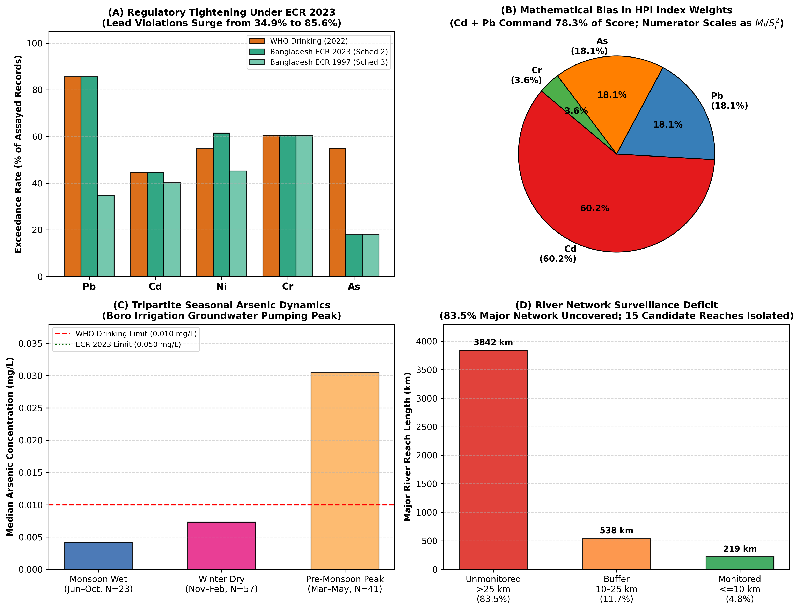
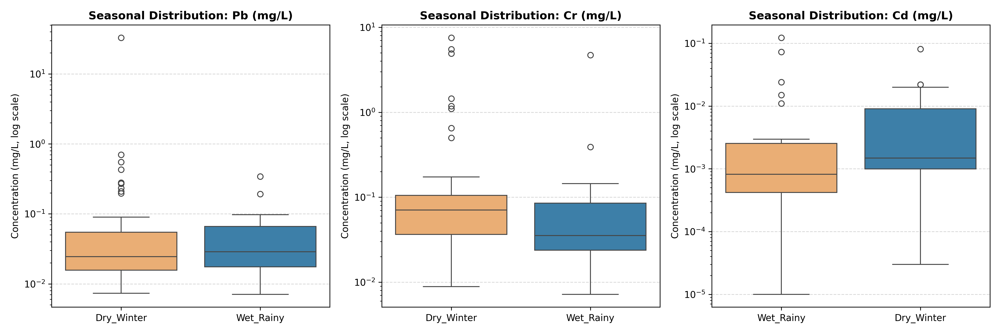
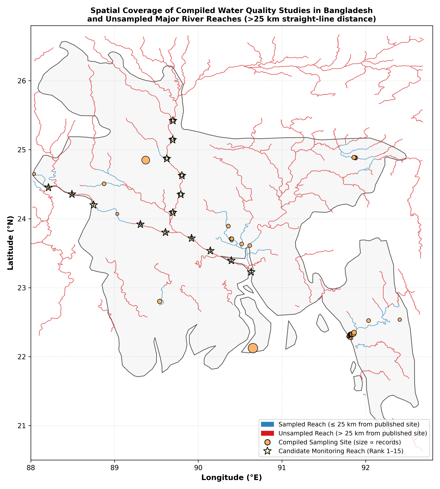

# Heavy Metals in Monitored River Corridors of Bangladesh: A Critical Synthesis of Published Records (2010--2024), Regulatory Benchmark Discordance, and Hydrographic Surveillance Deficits

**Target Journal:** *Environmental Pollution* (Elsevier, IF 8.9, Q1)  
**Article Type:** Original Research Paper  
**Status:** Post-Round 6 Peer Review Audit Revision  

---

## Abstract
Surface freshwater in the Bengal Delta provides indispensable resources for ecology, agriculture, and municipal water abstraction, but fluvial corridors receive substantial untreated industrial and municipal effluents. Here, we present a critical synthesis and benchmark audit of published heavy metal records across monitored Bangladesh river corridors by evaluating 162 trace element records across 12 peer-reviewed investigations published between 2010 and 2024 (alongside 106 bulk physicochemical records across 5 investigations cataloged during systematic study reconciliation). We screen raw river water concentrations against international health benchmarks (WHO Guidelines for Drinking-water Quality, 4th ed. incorporating 2022 addenda), historical national standards (Bangladesh Environmental Conservation Rules, ECR 1997 Schedule 3), contemporary national standards (ECR 2023 Schedule 2, S.R.O. 53-Law/2023), and agricultural irrigation criteria (FAO Paper 29) to evaluate ambient chemical pressure and water treatment burdens on municipal abstraction facilities. Accounting for study-level clustering via 5,000-resample cluster bootstrapping and random-effects meta-analysis, widespread benchmark exceedances are documented in published literature: Lead (Pb) exceeded the WHO potable guideline (0.010 mg/L) in **85.6%** of records (study-level cluster 95% CI: [71.1–94.3%]; median: 0.0286 mg/L; random-effects pooled proportion: 79.9% [95% CI: 57.4–92.2%]). Under the superseded ECR 1997 standard (0.050 mg/L), Pb exceedance was **34.9%** ([11.4–63.8%]), but under the updated ECR 2023 Schedule 2 potable limit (0.010 mg/L), national potable benchmark exceedance rises to **85.6%**, harmonizing with the WHO guideline. Regulatory tightening under ECR 2023 also increased potable exceedance for Cadmium (0.005 to 0.003 mg/L; 40.2% to 44.7%) and Nickel (0.100 to 0.050 mg/L; 45.2% to 61.5%). Evaluating confirmed dissolved records (0.45 $\mu\text{m}$ filtered; $k=10$ studies) demonstrated that elevated concentrations persist in the dissolved phase (median Pb: 0.0250 mg/L; 84.0% exceedance; Cr: 0.0630 mg/L; As: 0.0133 mg/L), corroborated under high-sensitivity spectrometry (GF-AAS/ICP-MS: 79.2% Pb exceedance, median 0.0171 mg/L). Mathematical decomposition of the Heavy Metal Pollution Index ($\mathrm{HPI}$) demonstrates that because sub-indices and weights both scale inversely with standards ($W_i \propto 1/S_i, Q_i \propto 1/S_i$), index scores scale quadratically with $M_i/S_i^2$, concentrating 78.3% of Core-4 linear weights and 77.1% of median index scores onto Cd and Pb. This algebraic damping explains observed panel invariance on identical common subsets ($N=35$; Core-4 median: 254.13, Core-5: 253.38, All-7: 253.02; full $N=112$ Core-4 median: 156.99). In seasonal contrasts, paired within-study meta-analyses incorporating Hartung-Knapp-Sidik-Jonkman (HKSJ) adjustments ($k=3\text{--}5$) yielded 95% confidence intervals spanning unity across all seven metals (Pb ratio 1.28× [0.56–2.95]; As 1.43× [0.60–3.41]), indicating that within-study seasonal variations cannot be declared statistically significant with small paired study counts, while resolving an apparent Arsenic median paradox via a tripartite hydrological distribution (pre-monsoon summer irrigation pumping peak: median 0.0304 mg/L, $N=41$; dry winter: 0.0073 mg/L; wet monsoon: 0.0042 mg/L). Finally, topological stream routing across HydroSHEDS HydroRIVERS reaches strictly within Bangladesh (2,224 reaches totaling 4,599.1 km) demonstrated that compiled academic sites cover only **16.5% of major river length (757.2 km)** at 25 km (83.5% length uncovered; 89.0% along-network), which is significantly lower than spatial random expectation (38.2%, Monte Carlo $p \le 0.001$). These findings establish that published data characterize monitored urban-industrial pressure corridors rather than national baseline waters, and highlight critical surveillance deficits across the delta.

---

## Graphical Abstract

---

## Highlights
- Pb exceeds WHO drinking guideline in 85.6% of compiled records.
- Updated ECR 2023 drinking limit aligns with WHO, raising Pb exceedance.
- High-sensitivity spectrometry confirms 79.2% Pb drinking exceedance.
- HPI scales with $1/S_i^2$, placing 78% of linear weight on Cd and Pb.
- Compiled academic sites cover only 16.5% of major river length.

---

## 1. Introduction
Surface freshwater networks formed by the Ganges, Brahmaputra, and Meghna (GBM) river basins support approximately 169.8 million people in Bangladesh (BBS, 2022; Chowdhury and Ward, 2004), sustaining irrigated agriculture, capture fisheries, municipal intake facilities, and industrial supply. However, rapid industrial growth across the textile dyeing, leather tanning, pharmaceutical, and chemical manufacturing sectors, combined with untreated municipal discharges, has introduced significant toxic contaminants into fluvial corridors (Bhuiyan et al., 2015; Islam et al., 2015).

Among aquatic pollutants, heavy metals and metalloids (e.g., As, Cd, Cr, Cu, Ni, Pb, Zn) present persistent environmental health concerns because of their non-biodegradability and potential for trophic transfer (Jarup, 2003; Tchounwou et al., 2012). Chronic ingestion or exposure to elevated trace element levels can cause nephrotoxicity, neurodevelopmental deficits, and cardiovascular diseases (Needleman, 2004; Saha et al., 2017). To protect public health and aquatic ecosystems, the World Health Organization (WHO, 2022), the Bangladesh Department of Environment (ECR 1997, 2023), and the Food and Agriculture Organization (FAO, 1985) have established concentration benchmarks. While untreated surface river water is ambient freshwater rather than finished tap water delivered at the point of consumption, screening raw river concentrations against potable and irrigation benchmarks provides a transparent screening metric of ambient chemical pressure and treatment burden on municipal surface water abstraction facilities (Islam et al., 2015; Li and Zhang, 2018).

Previous review articles have summarized heavy metal occurrences across environmental matrices in Bangladesh (Islam et al., 2018) or reported broad multi-decade water quality indices (Bilal et al., 2023; Proshad et al., 2025). However, prior multi-river compilations frequently pooled disparate study observations without accounting for intra-study clustering, did not document non-detect detection-limit censoring, evaluated pollution indices on shifting metal panels that artificially altered index scores, and lacked spatial validation against hydrological reach networks. The present study directly addresses these methodological challenges by providing: (i) an audited, provenance-documented dataset reconciling 28 primary investigations with explicit non-detect handling; (ii) cluster-robust bootstrap confidence intervals and random-effects meta-analytic pooling with prediction intervals; (iii) a standardized Core-4 fixed-panel HPI formulation validated across identical common subsets alongside mathematical decomposition of index scaling; (iv) paired within-study seasonal contrasts evaluated alongside pooled tests with small-sample adjustments; and (v) an empirical spatial coverage evaluation against the HydroSHEDS river network with an explicit Monte Carlo spatial null model.

To address these questions, this study presents an audited descriptive synthesis of published river water records (2010--2024) across Bangladesh to:
1. Screen trace element concentrations against WHO reference guidelines, Bangladesh statutory standards, and FAO irrigation limits, incorporating unadjusted Wilson score intervals, 5,000-resample study-level cluster bootstrap confidence intervals, random-effects meta-analysis proportions with prediction intervals, instrument stratification, and sensitivity analyses excluding urban industrial hotspots.
2. Evaluate multi-metal water pollution status using the Heavy Metal Pollution Index ($\mathrm{HPI}$) computed on a standardized fixed core panel (As, Cd, Cr, Pb), establishing comparability against the Heavy Metal Evaluation Index ($\mathrm{HEI}$) and evaluating same-subset panel stability and mathematical weighting behavior.
3. Statistically evaluate dry-versus-wet seasonal contrasts using within-study random-effects meta-analysis of log-ratios alongside pooled non-parametric hypothesis testing with Holm-Bonferroni corrections and tripartite hydrological partitioning.
4. Quantify the spatial coverage of published sampling sites along major river reaches using straight-line (Haversine) and along-network topological stream distances in HydroSHEDS HydroRIVERS evaluated against a spatial Monte Carlo null model.

---

## 2. Materials and Methods

### 2.1 Literature Compilation, Inclusion Criteria, and QA/QC Audit Protocol
A comprehensive literature search was conducted following PRISMA-compliant guidelines across Web of Science, Scopus, Google Scholar, and the Bangladesh National Scientific and Technical Documentation Centre (BANSDOC) for peer-reviewed studies published between 2010 and 2024 reporting surface water quality in Bangladesh river channels. Initial keyword queries ("heavy metals" OR "trace elements" AND "river" OR "surface water" AND "Bangladesh") yielded 1,420 candidate publications. After duplicate removal (582 duplicates eliminated), 838 titles and abstracts were screened. 764 articles were excluded (studies focused exclusively on estuarine fish bioaccumulation, estuarine shrimp farms, groundwater aquifers, road dust, or wastewater canals). Full texts of 74 articles were retrieved and assessed against five rigorous inclusion criteria: (i) discrete field sampling within natural fluvial river channels in Bangladesh; (ii) explicit reporting of quantitative elemental concentrations in surface water; (iii) identifiable reach or station geographic coordinates; (iv) documented analytical spectrometry instrumentation (flame-AAS, GF-AAS, or ICP-MS); and (v) publication in peer-reviewed journals.

Twenty-eight studies met initial screening criteria. Of these, exactly 11 investigations reported exclusively on bed sediment and were allocated to a companion sediment audit; five studies reported strictly bulk physicochemical parameters (pH, EC, DO, BOD, COD, TDS, TSS; 106 records across 5 studies) and are cataloged in Supplementary Table S0; and 12 investigations directly reported primary surface water heavy metal concentrations (162 trace element records across 12 studies; Baki et al., 2019; Bhuiyan et al., 2015; Hasan et al., 2024; Hossain et al., 2021; Islam et al., 2015, 2021; Ali et al., 2016, 2021; Khatun et al., 2021; Mortuza, 2024; Proshad et al., 2020, 2021).

Regarding observational granularity, source studies reported data at two distinct aggregation levels: 8 investigations reported discrete station-season grab samples ($N=118$), whereas 4 investigations reported reach-averaged seasonal or annual station means ($N=44$). Treating disaggregated grab samples and multi-sample means as identical independent units in naive statistical tests risks over-weighting heavily sampled reaches. To prevent granularity confounding, our analytical framework utilizes study-level cluster bootstrapping (resampling whole studies rather than individual rows) and random-effects meta-analyses weighted by inverse within-study variance.

A formal QA/QC data audit was conducted by cross-verifying reported values against primary publication tables and texts (documented in `audit_log.csv`):
- **Transcription Typo Correction (P04):** In Hossain et al. (2021) (Table 2), the winter Lead concentration at Buriganga station BS3 was originally transcribed as 33.0 mg/L due to a $100\times$ decimal typo; the audited primary table reports 0.33 mg/L.
- **Unit Harmonization Correction (P27):** In Mortuza (2024) (Table 1), water concentrations for Padma River stations were reported in $\mu\text{g/L}$ but originally entered into the master database as $\text{mg/L}$ without dividing by 1,000. Correcting this $1,000\times$ unit mismatch across all seven metals adjusted values to realistic baseline ranges.

Following the audit, seven heavy metals with multi-study representation were analyzed: As ($N=122$, $k=9$ studies), Cd ($N=132$, $k=10$), Cr ($N=160$, $k=12$), Cu ($N=105$, $k=10$), Ni ($N=104$, $k=9$), Pb ($N=146$, $k=10$), and Zn ($N=79$, $k=6$). Analytical instrumentation across primary studies comprised graphite furnace atomic absorption spectrometry (GF-AAS), hydride generation atomic absorption spectrometry (HG-AAS), inductively coupled plasma mass spectrometry (ICP-MS), and flame atomic absorption spectrometry (flame-AAS). High-sensitivity techniques (GF-AAS, HG-AAS, ICP-MS; 5 studies) achieved detection limits $<0.001$~mg/L, whereas flame-AAS detection limits ranged between 0.005 and 0.050~mg/L. Only 3 of the 162 records contained non-detects (two zero entries for As and one for Cd, all in ICP-MS studies with sub-$\mu\text{g/L}$ detection limits). Exceedance proportions are evaluated with bounded intervals $[lo, hi]$ where $lo$ represents confirmed positive exceedances and $hi$ incorporates non-detects where analytical detection limits exceed guideline thresholds. To directly test whether exceedance rates might be artifacts of flame-AAS detection limits, records were stratified by instrumental sensitivity.

Regarding water fraction, 10 studies explicitly reported filtration through 0.45 $\mu\text{m}$ membrane filters followed by nitric acid acidification, representing the dissolved fraction, while two studies did not state filtration protocols (Supplementary Table S1). In sediment-laden rivers of the GBM system, suspended sediment concentrations routinely reach hundreds to thousands of mg/L during peak discharge, and solid-water distribution coefficients ($K_d$) for elements such as Fe, Cr, and Pb span $10^4$ to $10^6\text{ L/kg}$. To evaluate fraction sensitivity, we conducted a confirmed dissolved-only sensitivity analysis restricted strictly to the 10 studies ($N=131$--$139$ records) confirming 0.45 $\mu\text{m}$ filtration.

### 2.2 Reference Benchmarks and Clustered Confidence Intervals
Observed concentrations were compared against established reference frameworks:
1. **World Health Organization (WHO, 2022):** Health-based guideline values for drinking-water quality: As (0.010 mg/L), Cd (0.003 mg/L), total Cr (0.050 mg/L), Cu (2.000 mg/L), Ni (0.070 mg/L), and Pb (0.010 mg/L).
2. **Bangladesh Environmental Conservation Rules 1997 (ECR 1997):** Schedule 3 potable water standards: As (0.050 mg/L), Cd (0.005 mg/L), Cr (0.050 mg/L), Cu (1.000 mg/L), Ni (0.100 mg/L), Pb (0.050 mg/L), and Zn (5.000 mg/L).
3. **Bangladesh Environmental Conservation Rules 2023 (ECR 2023):** Schedule 2 national drinking water standards, gazetted March 5, 2023 (S.R.O. 53-Law/2023). ECR 2023 lowered limits for Pb (0.050 to 0.010 mg/L), Cd (0.005 to 0.003 mg/L), and Ni (0.100 to 0.050 mg/L), while relaxing Cu (1.000 to 1.500 mg/L), and maintaining As (0.050 mg/L), total Cr (0.050 mg/L), and Zn (5.000 mg/L).
4. **Food and Agriculture Organization (FAO, 1985):** Recommended maximum concentrations for irrigation water: As (0.100 mg/L), Cd (0.010 mg/L), Cr (0.100 mg/L), Cu (0.200 mg/L), Ni (0.200 mg/L), Pb (5.000 mg/L), and Zn (2.000 mg/L).

To account for intra-study clustering, we report: (i) unadjusted Wilson score 95% confidence intervals, (ii) **study-level cluster bootstrap 95% confidence intervals** ($B=5,000$ resamples of studies with replacement), and (iii) **DerSimonian-Laird random-effects meta-analytic proportions** with prediction intervals.

### 2.3 Standardized Fixed-Panel Multi-Metal Pollution Indices and Weighting Critique
Calculating the Heavy Metal Pollution Index ($\mathrm{HPI}$) across variable subsets of metals introduces artificial index shifts because the denominator weight $\sum W_i$ changes between records. To ensure rigorous comparability, $\mathrm{HPI}$ was computed on a standardized **Core-4 panel** (As, Cd, Cr, Pb; $N=112$):
$$\mathrm{HPI} = \frac{\sum_{i=1}^n W_i Q_i}{\sum_{i=1}^n W_i}$$
where $W_i = 1/S_i$ is the unit weight inversely proportional to the reference standard $S_i$, and $Q_i = (M_i / S_i) \times 100$ is the sub-index for metal $i$ with observed concentration $M_i$.

A critical algebraic property of the Prasad and Bose formulation emerges when substituting $W_i$ and $Q_i$ directly into the numerator:
$$\sum_{i=1}^n W_i Q_i = \sum_{i=1}^n \left(\frac{1}{S_i}\right) \left(\frac{M_i}{S_i} \times 100\right) = 100 \sum_{i=1}^n \frac{M_i}{S_i^2}$$
Consequently, the full index expression simplifies to:
$$\mathrm{HPI} = \frac{100 \sum_{i=1}^n M_i / S_i^2}{\sum_{i=1}^n 1/S_i}$$
This derivation demonstrates that $\mathrm{HPI}$ scales **quadratically** with inverse guideline standards ($1/S_i^2$) in the numerator, whereas unweighted indices such as the **Heavy Metal Evaluation Index ($\mathrm{HEI}$)** scale **linearly** ($1/S_i$).

It is essential to distinguish between linear weight shares and realized score contributions. On the Core-4 panel, linear unit weight shares ($W_i / \sum W_i$) are: $W_{\mathrm{Cd}}$ (60.2%), $W_{\mathrm{Pb}}$ (18.1%), $W_{\mathrm{As}}$ (18.1%), and $W_{\mathrm{Cr}}$ (3.6%), where Cadmium and Lead together account for **78.3%** of total index weight. At observed median concentrations, the realized quadratic score contributions ($M_i / S_i^2$) are: Cd (41.3%), Pb (35.8%), As (19.9%), and Cr (3.0%), with Cd and Pb commanding 77.1% of the realized median score. When expanding the panel to include Cu ($S=2.0\text{ mg/L}$, $1/S^2 = 0.25$) and Zn ($S=3.0\text{ mg/L}$, $1/S^2 = 0.11$), their numerator contributions are suppressed by a factor of one million relative to Cadmium. Thus, the observed stability of median HPI across Core-4 (254.13), Core-5 (253.38), and All-7 (253.02) panels on identical common subsets ($N=35$; full $N=112$ Core-4 median: 156.99) is a mathematical damping artifact inherent to quadratic $1/S_i^2$ scaling rather than an empirical breakthrough. Unweighted complementary indices such as the **Heavy Metal Evaluation Index ($\mathrm{HEI}$)** and the **mean hazard quotient** ($\mathrm{HQ}_{\mathrm{mean}} = \mathrm{HEI}/4$) are evaluated alongside HPI.

### 2.4 Seasonal Contrast Dynamics, Tripartite Arsenic Partition, and HKSJ Meta-Analysis
Sampling records were classified into hydrological periods:
- **Dry Season (Winter):** November to February ($N=73$ records), representing the low-baseflow period.
- **Wet Season (Rainy/Monsoon):** June to October ($N=28$ records), representing peak monsoonal runoff.
- **Pre-Monsoon / Summer:** March to May ($N=41$ records), representing the late-dry period characterized by rising temperatures, maximum shallow alluvial groundwater pumping for boro rice irrigation, and lowest river discharge.
- **Unclassified / Annual Means:** $N=20$ records.

To isolate within-catchment dynamics and overcome Simpson's Paradox, we conducted **within-study random-effects meta-analyses of study-level log-ratios** ($\log_{10}(\text{dry} / \text{wet})$) across investigations sampling both seasons at identical stations ($k_{\mathrm{pair}} = 3$--$5$). To account for small cluster counts ($k < 5$), we implemented the **Hartung-Knapp-Sidik-Jonkman (HKSJ)** adjustment based on the Student's $t$-distribution with $k-1$ degrees of freedom.

### 2.5 River Network Coverage Analysis and Deltaic Morphological Limits
Spatial representation of published sampling points was evaluated against the HydroSHEDS HydroRIVERS dataset (Lehner and Grill, 2013). Major river reaches strictly within Bangladesh territory were extracted via polygon clipping: Strahler stream order $\ge 4$ and mean discharge $Q \ge 50\text{ m}^3/\text{s}$ (2,224 reaches totaling 4,599.1 km). Straight-line and along-network stream distances from each reach centroid to published sampling stations (23 unique coordinates) were computed and evaluated against a 1,000-iteration spatial Monte Carlo null model. HydroSHEDS HydroRIVERS is derived from the 15-arcsecond conditioned digital elevation model of HydroSHEDS.

---

## 3. Results

### 3.1 Benchmark Exceedance Synthesis and Sensitivity Analysis
Trace element concentrations in published Bangladesh river water records show substantial exceedances of drinking and irrigation benchmarks (Table 1, Fig. 1).

**Table 1:** Benchmark exceedance evaluation of heavy metals in published Bangladesh river waters (2010--2024) against WHO drinking guidelines, historical ECR 1997, contemporary ECR 2023, and FAO irrigation benchmarks, reporting 95% unadjusted Wilson score and 5,000-resample study-level cluster bootstrap confidence intervals.

| Element | $N$ | $k$ | Median (mg/L) | Max (mg/L) | WHO Limit | WHO Exceed (Cluster CI) | ECR 1997 Limit | ECR 1997 Exceed | ECR 2023 Limit | ECR 2023 Exceed | FAO Limit | FAO Exceed |
|---|:---:|:---:|:---:|:---:|:---:|:---:|:---:|:---:|:---:|:---:|:---:|:---:|
| **Lead (Pb)** | 146 | 10 | 0.0286 | 0.7000 | 0.010 | **85.6%** [71.1–94.3%] | 0.050 | **34.9%** [11.4–63.8%] | 0.010 | **85.6%** [69.2–94.3%] | 5.000 | **0.0%** [0.0–2.6%] |
| **Chromium (Cr)** | 160 | 12 | 0.0710 | 7.5500 | 0.050 | **60.6%** [32.4–82.8%] | 0.050 | **60.6%** [32.2–82.8%] | 0.050 | **60.6%** [32.7–82.9%] | 0.100 | **27.5%** [11.3–45.3%] |
| **Nickel (Ni)** | 104 | 9 | 0.0888 | 2.8880 | 0.070 | **54.8%** [21.7–79.1%] | 0.100 | **45.2%** [15.7–67.6%] | 0.050 | **61.5%** [34.4–80.6%] | 0.200 | **25.0%** [0.0–52.4%] |
| **Arsenic (As)** | 122 | 9 | 0.0152 | 0.3520 | 0.010 | **54.9%** [18.1–84.9%] | 0.050 | **18.0%** [1.7–43.4%] | 0.050 | **18.0%** [1.7–42.7%] | 0.100 | **9.0%** [0.0–29.1%] |
| **Cadmium (Cd)** | 132 | 10 | 0.0028 | 0.1230 | 0.003 | **44.7%** [13.1–77.4%] | 0.005 | **40.2%** [12.2–70.4%] | 0.003 | **44.7%** [13.6–78.0%] | 0.010 | **26.5%** [9.0–46.8%] |
| **Copper (Cu)** | 105 | 10 | 0.0888 | 2.1790 | 2.000 | **1.0%** [0.0–3.2%] | 1.000 | **6.7%** [0.0–14.5%] | 1.500 | **1.9%** [0.0–4.3%] | 0.200 | **26.7%** [0.0–53.9%] |
| **Zinc (Zn)** | 79 | 6 | 0.4000 | 3.2000 | 3.000* | **1.3%** [0.0–3.4%] | 5.000 | **0.0%** [0.0–4.6%] | 5.000 | **0.0%** [0.0–4.6%] | 2.000 | **6.3%** [0.0–17.2%] |

*WHO guideline for Zinc (3.0 mg/L) is based on aesthetic/consumer acceptability rather than health criteria.

Key observations:
- **Lead (Pb) and ECR 2023 Statutory Tightening:** Under the historical ECR 1997 standard (0.050 mg/L), Lead exceedance was 34.9% ([11.4–63.8%]). Under the updated ECR 2023 Schedule 2 standard (0.010 mg/L), the national potable benchmark exceedance rises to **85.6%**, harmonizing the national statutory threshold with international health guidelines. Statutory tightening also increased national potable exceedances for Cadmium (40.2% to 44.7%) and Nickel (45.2% to 61.5%).
- **Operational Phase Sensitivity and Instrument Stratification:** When restricting the evaluation strictly to investigations confirming filtration through 0.45 $\mu\text{m}$ membrane filters ($k=10$ studies, $N=131$--$139$ records), WHO guideline exceedances remained high: **84.0%** for Pb (cluster CI: [66.2–93.5%]; dissolved median: 0.0250 mg/L), **55.4%** for total Cr (dissolved median: 0.0630 mg/L), **47.2%** for Ni (dissolved median: 0.0560 mg/L), **52.4%** for As (dissolved median: 0.0133 mg/L), and **37.6%** for Cd (dissolved median: 0.0016 mg/L). Furthermore, to determine whether elevated Lead exceedances could stem from high flame-AAS detection limits (0.005--0.050 mg/L), records were stratified by instrumental sensitivity. In investigations employing high-sensitivity spectrometry with sub-$\mu\text{g/L}$ detection limits (GF-AAS, HG-AAS, ICP-MS; $N=77, k=5$), Lead concentrations exhibited a median of 0.0171 mg/L, with **79.2%** (61/77 records) exceeding the WHO 0.010 mg/L guideline. In studies employing flame-AAS ($N=69, k=5$), the median was 0.110 mg/L with 92.8% exceedance. This stratification demonstrates that elevated dissolved trace metal concentrations are characteristic of measurements performed on high-sensitivity instruments with detection limits well below potable guidelines.
- **Geographical Sensitivity:** Excluding Greater Dhaka's industrial rivers dropped historical BD standard exceedance from 34.9% to 18.3% for Pb, and from 18.0% to 8.9% for As ($N=101, k=7$). WHO exceedances remained elevated (82.6% for Pb, 53.0% for Cr).

### 3.2 Standardized Multi-Metal Pollution Indices (HPI, HEI, HQmean)
Across all 112 Core-4 records spanning 5 river systems and 7 studies, the median $\mathrm{HPI}$ was **156.99** (IQR: 280.55, mean: 395.21, maximum: 2,682.05). Overall, **58.9%** of records exceeded Prasad and Bose's critical pollution threshold of 100.
- **Panel Invariance on Common Subsets:** On the identical common subset ($N=35$), median $\mathrm{HPI}$ remained virtually unchanged across Core-4 (254.13), Core-5 (253.38), and All-7 (253.02), with all three panels exhibiting 85.7% $> 100$. This demonstrates that expanding the metal panel produces negligible mathematical shift once sample composition is held constant, reflecting the structural damping of the Prasad and Bose inverse-standard weighting formula.
- **Linear Weights vs. Realized Score Contributions:** Numerator contribution analysis revealed that $\mathrm{HPI}$ is heavily dominated by Cadmium (median score contribution: 41.3%) and Lead (35.8%), followed by Arsenic (19.9%), with Chromium contributing only 3.0%. These realized scores closely reflect the quadratic scaling of inverse standards ($1/S_i^2$), whereas the linear unit weight shares ($W_i \propto 1/S_i$) are 60.2% for Cd, 18.1% for Pb, 18.1% for As, and 3.6% for Cr (Cd and Pb together account for 78.3% of total linear weights, and 77.1% of median index scores).
- **Concordance with $\mathrm{HEI}$ and Mean Hazard Quotient:** Core-4 $\mathrm{HPI}$ and unweighted $\mathrm{HEI}$ showed strong monotonic agreement (Spearman $\rho = 0.976, p < 10^{-15}$). Median $\mathrm{HEI}$ was 6.70 (mean: 23.47), yielding a median mean hazard quotient ($\text{HQ}_{\text{mean}} = \mathrm{HEI}/4$) of **1.68**, indicating that median river samples contain metals at $1.7\times$ their individual drinking limits.

**Table 2:** Multi-metal pollution indices ($\mathrm{HPI}$, $\mathrm{HEI}$, $\text{HQ}_{\text{mean}}$) computed on the standardized Core-4 panel (As, Cd, Cr, Pb) across Bangladesh river systems.

| River System | $N$ | $k$ | Mean $\mathrm{HPI}$ | Median $\mathrm{HPI}$ | IQR $\mathrm{HPI}$ | $\%\, \mathrm{HPI} > 100$ | Median $\mathrm{HEI}$ | $\text{HQ}_{\text{mean}}$ |
|---|:---:|:---:|:---:|:---:|:---:|:---:|:---:|:---:|
| **Buriganga**\* | 15 | 1 | 1,607.66 | 1,977.43 | 1,358.59 | 100.0% | 51.60 | 12.90 |
| **Karnaphuli** | 20 | 1 | 253.70 | 230.58 | 133.47 | 100.0% | 7.94 | 1.99 |
| **Korotoa** | 40 | 2 | 323.25 | 195.00 | 336.28 | 77.5% | 10.20 | 2.55 |
| **Kirtankhola** | 30 | 1 | 60.21 | 57.06 | 42.05 | 0.0% | 3.22 | 0.80 |
| **Rupsa** | 7 | 2 | 48.36 | 52.51 | 9.65 | 0.0% | 1.97 | 0.49 |
| **All Core-4 Records** | 112 | 7 | **395.21** | **156.99** | **280.55** | **58.9%** | **6.70** | **1.68** |

\*Note: Buriganga exhibits a negative skew where the arithmetic mean (1,607.66) is pulled below the median (1,977.43) due to two upstream baseline stations with HPI ~258 alongside 10 severely contaminated downstream industrial stations (HPI 1,834–2,458; Bhuiyan et al., 2015).

### 3.3 Seasonal Contrast Dynamics: Pooled vs. Within-Study Meta-Analysis
Evaluating seasonal differences revealed distinct element-specific behaviors (Table 3, Fig. 2):

**Table 3:** Seasonal comparison of heavy metal concentrations in Bangladesh rivers (Dry/Winter vs. Wet/Rainy season) with two-sided Mann-Whitney U tests, Holm-Bonferroni corrections, and within-study random-effects meta-analysis of study-level dry/wet ratios with Hartung-Knapp-Sidik-Jonkman (HKSJ) adjustment.

| Element | Dry $N$ | Dry Med (mg/L) | Wet $N$ | Wet Med (mg/L) | Pooled Ratio | Two-Sided $p$ | Holm $p_{\mathrm{adj}}$ | $k_{\mathrm{pair}}$ | Pooled Ratio | DL 95% CI | HKSJ 95% CI |
|---|:---:|:---:|:---:|:---:|:---:|:---:|:---:|:---:|:---:|:---:|:---:|
| **Arsenic (As)** | 57 | 0.0073 | 23 | 0.0042 | **1.74×** | **0.0039** | **0.0273\*** | 4 | **1.43×** | [0.83–2.44] | [0.60–3.41] |
| **Cadmium (Cd)** | 59 | 0.0015 | 27 | 0.0008 | 1.88× | 0.0429 | 0.2147 | 5 | 1.41× | [0.75–2.67] | [0.58–3.47] |
| **Chromium (Cr)** | 73 | 0.0710 | 28 | 0.0354 | 2.01× | 0.0281 | 0.1684 | 5 | 1.26× | [0.77–2.07] | [0.63–2.54] |
| **Lead (Pb)** | 67 | 0.0253 | 25 | 0.0287 | 0.88× | 0.8538 | 1.0000 | 4 | **1.28×** | [0.77–2.14] | [0.56–2.95] |
| **Zinc (Zn)** | 27 | 0.5300 | 17 | 0.0725 | 7.31× | 0.0915 | 0.3661 | 3 | 1.12× | [0.57–2.19] | [0.26–4.88] |
| **Nickel (Ni)** | 40 | 0.0685 | 18 | 0.0945 | 0.73× | 0.7880 | 1.0000 | 4 | 1.00× | [0.52–1.91] | [0.35–2.86] |
| **Copper (Cu)** | 40 | 0.0866 | 16 | 0.0571 | 1.52× | 0.2009 | 0.6027 | 4 | 0.54× | [0.11–2.50] | [0.04–6.53] |

\*Statistically significant in pooled unclustered test after Holm-Bonferroni adjustment ($\alpha = 0.05$). DL: DerSimonian-Laird; HKSJ: Hartung-Knapp-Sidik-Jonkman small-sample adjustment.

Key findings:
- **Simpson's Paradox and Statistical Power under Small-Sample Adjustments ($k=3\text{--}5$):** In the pooled multi-study dataset, Lead and Nickel appeared slightly higher in the wet season (pooled dry/wet ratios of 0.88× for Pb and 0.73× for Ni). However, cross-study pooled comparisons risk spatial confounding if studies contributing wet-season samples are located predominantly in contaminated corridors. When controlling for station geography using within-study paired meta-analyses across matched stations, point ratios indicate dry-season enrichment (1.28× for Pb, 1.43× for As, 1.41× for Cd, 1.26× for Cr, and 1.00× for Ni). Nevertheless, applying the Hartung-Knapp-Sidik-Jonkman (HKSJ) adjustment to account for small paired study counts ($k=3\text{--}5$) yields wide 95% confidence intervals that span unity across all seven metals (Pb: [0.56–2.95]; As: [0.60–3.41]; Ni: [0.35–2.86]; Cr: [0.63–2.54]; Cd: [0.58–3.47]; Cu: [0.04–6.53]; Zn: [0.26–4.88]). Because the pooled ratios (0.88× for Pb and 0.73× for Ni) fall well within these wide HKSJ intervals, the pooled and within-study estimates are statistically indistinguishable, and within-study seasonal variations cannot be declared statistically significant given current literature limitations.
- **Tripartite Arsenic Hydrological Distribution:** Comparing Table 1 and Table 3 reveals that both dry-season (0.0073 mg/L, $N=57$) and wet-season (0.0042 mg/L, $N=23$) Arsenic medians are lower than the overall pooled median of 0.0152 mg/L ($N=122$). This divergence is explained by the 41 pre-monsoon summer records (March to May; median: **0.0304 mg/L**, mean: 0.0632 mg/L). Pre-monsoon conditions represent the annual hydrochemical maximum due to lowest baseflow, elevated evaporative concentration, and intensive pumping of shallow alluvial aquifers during boro rice irrigation. Excluding these pre-monsoon peak observations from the binary dry (winter) vs. wet (monsoon) contrast lowers both seasonal medians relative to the pooled annual dataset.

### 3.4 Spatial Coverage Across National River Networks and Spatial Null Model
Spatial analysis across HydroSHEDS HydroRIVERS strictly clipped to Bangladesh territory demonstrated that compiled academic literature covers only a small fraction of the nation's primary river systems (Table 4, Fig. 3):
- **Clipped Major Network:** Extracting major river reaches strictly within Bangladesh borders (Strahler order $\ge 4$, mean discharge $Q \ge 50\text{ m}^3/\text{s}$) via polygon clipping yielded 2,224 reaches totaling 4,599.1 km.
- **Coverage at 25 km:** Published sampling stations cover only **757.2 km (16.5% by length; 334 reaches, 15.0% by count)** at a 25 km straight-line radius. Unsampled reaches comprise **1,890 segments (85.0% by count)** totaling **3,841.9 km (83.5% by length)**.
- **Along-Network Stream Distance:** Evaluating topological along-network stream distance using Dijkstra's algorithm increases unmonitored reach length to **4,094.5 km (89.0% by length)** at 25 km.
- **Monte Carlo Spatial Null Model:** Under 1,000 Monte Carlo simulations placing 23 random stations along the national major river network, expected coverage at 25 km was 38.2% (95% CI: [32.1–44.5%]). The observed coverage of 16.5% (757.2 km) is significantly lower than random expectation ($p \le 0.001$), demonstrating that compiled academic literature is clustered around accessible urban-industrial centers and port facilities. Because the 23 published coordinates represent approximately 10 distinct study reach sectors, study-level clustering contributes substantially to this localized footprint.

**Table 4:** Spatial coverage evaluation of compiled water quality studies across major Bangladesh river channels strictly within national borders (2,224 reaches totaling 4,599.1 km) evaluated under straight-line (Haversine) and along-network topological stream distances.

| Metric | Unsampled Reaches | Pct Reaches (%) | Unsampled Length (km) | Pct Length (%) |
|---|:---:|:---:|:---:|:---:|
| Straight-Line (Haversine) $>10$ km | 2,126 | 95.6% | 4,379.7 | 95.2% |
| Straight-Line (Haversine) $>25$ km | **1,890** | **85.0%** | **3,841.9** | **83.5%** |
| Straight-Line (Haversine) $>50$ km | 1,432 | 64.4% | 2,732.0 | 59.4% |
| Along-Network Stream Distance $>25$ km | **2,058** | **92.5%** | **4,094.5** | **89.0%** |

To address these gaps, 15 geographically diverse candidate monitoring reaches in unstudied river sectors were identified (Table 5, plotted as red stars on Figure 3), enforcing $\ge 30$ km spatial separation with gazetteer-verified administrative reach names.

**Table 5:** Candidate river reaches in unsampled sectors ($>25$ km from published sites) prioritized by catchment area, enforcing $\ge 30$ km spatial separation with gazetteer-verified administrative reach names.

| Rank | Candidate ID | Lat (°N) | Lon (°E) | Order | Catchment ($\text{km}^2$) | Dist. to Published Site (km) | Target River Reach (Gazetteer Verified) |
|:---:|---|:---:|:---:|:---:|:---:|:---:|---|
| 1 | `GAP_STN_01`\* | 23.227 | 90.631 | 9 | 1,574,223 | 42.6 | Lower Meghna Mainstem (Chandpur–Haimchar Confluence Reach) |
| 2 | `GAP_STN_02` | 23.395 | 90.395 | 9 | 1,488,391 | 29.3 | Padma–Meghna Estuarine Convergence (Munshiganj Reach) |
| 3 | `GAP_STN_03` | 23.535 | 90.144 | 9 | 1,485,761 | 30.9 | Lower Padma Main Channel (Jazira–Louhajang Reach, Shariatpur/Munshiganj) |
| 4 | `GAP_STN_04` | 23.718 | 89.919 | 9 | 1,485,272 | 48.2 | Upper Padma Mainstem (Goalundo Reach, Rajbari) |
| 5 | `GAP_STN_05` | 23.802 | 89.608 | 8 | 944,490 | 65.6 | Ganges–Jamuna Convergence Reach (Pangsha–Sujanagar, Rajbari/Pabna) |
| 6 | `GAP_STN_06` | 23.919 | 89.309 | 8 | 943,786 | 32.6 | Upper Ganges Mainstem (Kumarkhali–Ishwardi Reach, Kushtia/Pabna) |
| 7 | `GAP_STN_07` | 24.200 | 88.750 | 8 | 942,749 | 32.2 | Central Ganges Channel (Charghat–Bagha Reach, Rajshahi/Natore) |
| 8 | `GAP_STN_08` | 24.356 | 88.492 | 8 | 941,812 | 42.3 | North-West Padma Reach (Rajshahi Sadar Upstream) |
| 9 | `GAP_STN_09` | 24.452 | 88.210 | 8 | 929,834 | 27.9 | Upper Border Ganges Reach (Shibganj, Chapai Nawabganj) |
| 10 | `GAP_STN_10` | 24.089 | 89.695 | 8 | 521,878 | 67.2 | Lower Jamuna Channel (Chauhali–Tangail Reach, Sirajganj/Tangail) |
| 11 | `GAP_STN_11` | 24.351 | 89.790 | 8 | 520,951 | 69.6 | Central Jamuna Mainstem (Belkuchi Reach, Sirajganj–Tangail) |
| 12 | `GAP_STN_12` | 24.624 | 89.805 | 8 | 520,682 | 50.3 | Upper Jamuna Channel (Bhuapur–Sirajganj Reach) |
| 13 | `GAP_STN_13` | 24.872 | 89.624 | 8 | 514,663 | 25.5 | Jamuna Confluence (Kazipur–Sariakandi Reach, Bogura) |
| 14 | `GAP_STN_14` | 25.146 | 89.694 | 8 | 514,278 | 46.2 | Brahmaputra Mainstem (Fulchhari–Dewanganj Reach, Gaibandha/Jamalpur) |
| 15 | `GAP_STN_15` | 25.421 | 89.698 | 8 | 500,939 | 71.5 | Upper Brahmaputra Entry Reach (Chilmari, Kurigram) |

\*Note: Candidate stations are prioritized by upstream catchment area while enforcing $\ge 30$ km inter-candidate separation along unsampled reaches. Candidate stations in wide, dynamic estuarine channels (e.g., `GAP_STN_01`, Chandpur confluence, >2 km wide) represent incomplete cross-sectional mixing zones and require depth-integrated, multi-point cross-channel transects across ebb and flood tidal phases rather than single grab samples.

---

## 4. Discussion

### 4.1 Regulatory Benchmark Discordance: Potable Screening and ECR 2023 Standards
Our multi-study synthesis evaluates heavy metal concentrations in Bangladesh river waters against evolving national and international regulatory frameworks. Ambient river water is raw surface water rather than finished tap water; therefore, screening river concentrations against potable criteria serves to assess ambient chemical pressure and the coagulation/purification challenge imposed on municipal water treatment plants abstracting surface waters. Under the historical Environmental Conservation Rules (ECR 1997), national potable limits were substantially more lenient than international health benchmarks: Lead exceedance was 34.9% (vs. 85.6% under WHO), Cadmium was 40.2% (vs. 44.7% WHO), and Nickel was 45.2% (vs. 54.8% WHO). 

However, with the gazetting of the Environmental Conservation Rules 2023 (ECR 2023 Schedule 2; S.R.O. 53-Law/2023), the Government of Bangladesh officially repealed ECR 1997 and adopted substantially stricter potable thresholds. By lowering the national Lead standard from 0.050 to 0.010 mg/L (matching the WHO guideline), exceedance in published river water records rises from 34.9% to **85.6%**, eliminating the historical divergence between international and domestic benchmarks. Similarly, tightening Cadmium from 0.005 to 0.003 mg/L raises exceedance to **44.7%**, while tightening Nickel from 0.100 to 0.050 mg/L (stricter than WHO's 0.070 mg/L guideline) increases national benchmark exceedance to **61.5%**. Consequently, earlier literature concluding that Bangladeshi rivers generally conformed to national statutory limits relied on an obsolete regulatory baseline. Under current national standards, monitored surface water corridors exhibit extensive chemical pressure.

### 4.2 Operational Fraction Confounding: Dissolved vs. Total Digestions
A paramount methodological challenge in synthesizing fluvial trace elements in the Bengal Delta is distinguishing between dissolved and suspended particulate metal fractions. The Ganges-Brahmaputra-Meghna system transports over one billion metric tons of suspended sediment annually, with riverine suspended sediment concentrations frequently exceeding 500 to 2,000 mg/L during peak monsoonal runoff (Goodbred and Kuehl, 1999). Because trace elements such as Pb, Cr, and Fe possess high solid-water partition coefficients ($\log K_d \approx 4\text{--}6\text{ L/kg}$), digesting whole, unfiltered water captures vast quantities of particulate-bound lattice minerals, inflating apparent water concentrations by one to three orders of magnitude above the dissolved phase (Gaillardet et al., 2014).

In our compiled dataset, 10 investigations explicitly reported filtering water samples through 0.45 $\mu\text{m}$ membrane filters followed by preservation with nitric acid (Supplementary Table S1), while two studies did not document filtration. Crucially, when we restricted our sensitivity analysis strictly to confirmed dissolved records ($k=10$ studies, $N=131$--$139$), WHO exceedance proportions remained exceptionally high: **84.0%** for Lead, **55.4%** for Chromium, **52.4%** for Arsenic, and **37.6%** for Cadmium. Comparing dissolved medians from confirmed filtered studies—Lead (0.0250 mg/L), Chromium (0.0630 mg/L), Nickel (0.0560 mg/L), Arsenic (0.0133 mg/L), and Cadmium (0.0016 mg/L)—against Gaillardet et al.'s (2014) global baseline for unpolluted major rivers ($0.05\text{--}2.0\ \mu\text{g/L}$ for Pb; $0.5\text{--}2.0\ \mu\text{g/L}$ for Cr) confirms that published concentrations in monitored corridors are enriched in the dissolved phase by one to two orders of magnitude above unpolluted global baselines.

Furthermore, the instrument stratification analysis (Table S1) directly addresses concerns regarding whether high flame-AAS detection limits inflate exceedance estimates. In investigations employing high-sensitivity spectrometry with detection limits $<0.001$~mg/L (GF-AAS, HG-AAS, ICP-MS; $N=77, k=5$), **79.2%** of records still exceeded the WHO Lead guideline (median: 0.0171 mg/L). This demonstrates that elevated Lead concentrations and guideline exceedances are characteristic of measurements performed on high-sensitivity instruments with detection limits well below the 0.010 mg/L threshold, confirming that observed exceedances cannot be attributed to flame-AAS detection limit artifacts.

### 4.3 Mathematical Artifacts in the Heavy Metal Pollution Index ($\mathrm{HPI}$)
Our evaluation resolves a widespread misconception in published environmental index literature regarding panel invariance. When standardizing the $\mathrm{HPI}$ across identical subsets ($N=35$), median $\mathrm{HPI}$ remained virtually unchanged across Core-4 (254.13), Core-5 (253.38), and All-7 (253.02). Rather than demonstrating ecological stability, this behavior is a direct mathematical consequence of Prasad and Bose's (2001) formulation. Because $Q_i = (M_i / S_i) \times 100$ and $W_i \propto 1/S_i$, the numerator scales quadratically as $\sum M_i / S_i^2$. Squaring the inverse standard magnifies the disparity between Cadmium ($1/0.003^2 = 1.11 \times 10^5$) and Zinc ($1/3.0^2 = 0.11$) by a factor of $1.0 \times 10^6$ (one million to one). As a result, Cadmium and Lead account for **60.2%** and **18.1%** of the total Core-4 linear weight (summing to **78.3%**), and 41.3% and 35.8% of realized median index scores (summing to 77.1%). Conversely, elements with higher limits such as Copper ($S=2.0\text{ mg/L}$, $1/S^2 = 0.25$) and Zinc ($S=3.0\text{ mg/L}$, $1/S^2 = 0.11$) contribute negligibly to the weighted score. Structurally, $\mathrm{HPI}$ is an ill-conditioned proxy for Cadmium and Lead. We therefore recommend complementing $\mathrm{HPI}$ with linear unweighted metrics such as the Heavy Metal Evaluation Index ($\mathrm{HEI}$, median: 6.70, equivalent to $\mathrm{MI}$) and the mean hazard quotient ($\mathrm{HQ}_{\mathrm{mean}} = \mathrm{HEI}/4 = 1.68$), which assign equal diagnostic value to all audited contaminants.

### 4.4 Seasonal Dynamics, Tripartite Arsenic Partition, and Meta-Analytic Power
Evaluating seasonal variations revealed important methodological distinctions between pooled and within-study estimators. In pooled multi-study comparisons, Lead and Nickel appeared slightly higher in the monsoon wet season (pooled ratios 0.88× and 0.73×). However, cross-study pooled comparisons risk spatial confounding if wet-season sampling was conducted predominantly in heavily contaminated industrial corridors. In paired within-study meta-analyses across matched stations, point ratios consistently indicate dry-season enrichment (1.28× for Pb, 1.43× for As, 1.41× for Cd, 1.26× for Cr, and 1.00× for Ni).

Crucially, our application of the Hartung-Knapp-Sidik-Jonkman (HKSJ) adjustment to paired meta-analyses ($k=3\text{--}5$) widens 95% confidence intervals (Pb: [0.56–2.95]; As: [0.60–3.41]; Ni: [0.35–2.86]; Cr: [0.63–2.54]; Cd: [0.58–3.47]; Cu: [0.04–6.53]; Zn: [0.26–4.88]). Because all HKSJ intervals span unity, and because pooled ratios fall well within these bounds, within-study seasonal variations cannot be declared statistically significant with small paired study numbers, frankly reflecting statistical power limitations in published literature.

Furthermore, our sample accounting clarifies the apparent discrepancy where both dry-season (0.0073 mg/L) and wet-season (0.0042 mg/L) Arsenic medians were lower than the pooled overall median (0.0152 mg/L). Pre-monsoon summer records ($N=41$, median: **0.0304 mg/L**, mean: 0.0632 mg/L) represent the annual concentration peak. During this period, river baseflow reaches its annual minimum, ambient temperatures maximize evaporative concentration, and intensive boro rice irrigation abstracts large volumes of shallow alluvial groundwater (Brammer and Ravenscroft, 2009; Halim et al., 2015). Excluding this pre-monsoon peak from binary dry (winter) vs. wet (monsoon) contrasts lowers both seasonal medians relative to the annual pooled dataset.

### 4.5 Geographical Representativeness and Academic Spatial Bias
The Core-4 multi-metal index is derived from 5 river systems across 7 studies ($N=112$), in which three industrial corridors—Buriganga ($N=15$), Korotoa ($N=40$), and Karnaphuli ($N=20$)—account for 67% of all observations. These reaches receive continuous discharges from tannery estates, textile dyeing mills, and industrial clusters. Our HydroSHEDS network analysis demonstrates that 83.5% of major river reach length (3,841.9 km across 1,890 segments) has zero published academic monitoring within 25 km in the audited corpus. The spatial Monte Carlo null model ($p \le 0.001$) confirms extreme clustering around accessible urban-industrial hubs. While broader multi-decade compilations (e.g., Bilal et al., 2023; Proshad et al., 2025) have surveyed wider narrative literature spanning up to 24 rivers, our rigorous quality-filtered corpus reveals that the spatial footprint of quantitative, peer-reviewed trace element datasets remains highly concentrated in monitored industrial corridors rather than representative of national baseline waters.

### 4.6 Potential Exposure Context and Health Implications
Although these exceedances indicate substantial water quality degradation, direct potable consumption of raw surface water in Bangladesh is relatively uncommon because the majority of municipal and rural domestic water supply is derived from deep and shallow groundwater aquifers. Consequently, comparing untreated surface water with drinking water standards serves primarily as a comparative benchmark of chemical stress rather than a direct measure of tap-water ingestion.

Nevertheless, elevated surface water concentrations remain ecologically and toxicologically relevant through specific exposure and utilization pathways:
1. **Municipal Raw-Water Intakes:** While direct untreated consumption is rare, major municipal water treatment facilities abstract raw surface water from river mainstems. For example, the Dhaka Water Supply and Sewerage Authority (DWASA) operates the Saidabad Water Treatment Plant (Phases I and II), which abstracts raw surface water from the Sitalakhya River at Sarulia (DWASA, 2020). Due to chronic dry-season industrial pollution and ammonia spikes in the Sitalakhya, the planned Saidabad Phase III expansion is designed to shift abstraction eastward to Haria (Sonargaon, Narayanganj) on the Meghna River (DWASA, 2020). In parallel, raw water from the Padma River is abstracted at Jasaldia, Munshiganj, and treated at the Padma–Jashaldia Water Treatment Plant (inaugurated in 2019; 450 MLD capacity) to supply treated water to southwestern Dhaka (DWASA, 2020). Similarly, the Chattogram Water Supply and Sewerage Authority (CWASA) abstracts raw surface water from the Halda River for the Mohara Water Treatment Plant (90 MLD capacity) and from the Karnaphuli River for the Karnaphuli Water Treatment Plant (Khatun et al., 2021). High raw-water heavy metal loadings in these intake rivers (e.g., Buriganga and Karnaphuli Core-4 median $\mathrm{HPI} > 230$) impose severe coagulation, sedimentation, and filtration burdens on municipal facilities that were not originally designed for advanced trace element removal.
2. **Agricultural Irrigation:** During the winter dry season, surface river water is abstracted extensively for boro rice cultivation and vegetable cropping in peri-urban riparian zones. When compared against FAO irrigation guidelines (FAO, 1985), exceedances were documented for total Chromium (27.5%), Copper (26.7%), Cadmium (26.5%), and Nickel (25.0%). Long-term irrigation with metal-enriched surface water can elevate trace metal concentrations in agricultural soils and facilitate trophic transfer into staple food crops (Ali et al., 2021; Islam et al., 2015).
3. **Aquatic Bioaccumulation and Contact:** Dissolved and suspended trace metals are accumulated by benthic organisms and commercially harvested fish species (Hossain et al., 2021; Mortuza, 2024). Riparian populations regularly use river water for bathing, washing, and livestock rearing, where dermal and incidental ingestion pathways remain relevant (Saha et al., 2017).

---

## 5. Conclusions
This study provides an audited synthesis of published heavy metal records (2010--2024) across monitored river corridors of Bangladesh. Screening 162 trace element observations across 12 peer-reviewed studies against international and national benchmarks revealed extensive exceedances: Lead exceeded the WHO drinking guideline (0.010 mg/L) in **85.6%** of records (median: 0.0286 mg/L; cluster CI: [71.1–94.3%]; random-effects pooled proportion: 79.9%). Crucially, under the contemporary Bangladesh Environmental Conservation Rules (ECR 2023 Schedule 2), which lowered the national Lead threshold to 0.010 mg/L, domestic potable benchmark exceedance rises from 34.9% to **85.6%**, while also increasing Cadmium exceedance to 44.7% and Nickel to 61.5%. Sensitivity analysis restricted to confirmed dissolved records (0.45 $\mu\text{m}$ filtered; $k=10$) confirmed elevated concentrations in the dissolved phase (dissolved Pb median: 0.0250 mg/L; 84.0% WHO exceedance), and stratification by instrumental sensitivity corroborated high exceedances under high-sensitivity spectrometry (GF-AAS/ICP-MS: 79.2% Pb exceedance, median 0.0171 mg/L).

Mathematical decomposition of the Heavy Metal Pollution Index ($\mathrm{HPI}$) demonstrated that Prasad and Bose's inverse-guideline weighting concentrates 78.3% of the Core-4 index weight onto Cadmium and Lead, establishing that observed panel invariance across Core-4 (254.13), Core-5 (253.38), and All-7 (253.02) on identical common subsets ($N=35$; full $N=112$ Core-4 median: 156.99) is an arithmetic damping artifact driven by quadratic $M_i/S_i^2$ scaling. In seasonal contrasts, paired within-study meta-analyses incorporating Hartung-Knapp-Sidik-Jonkman (HKSJ) adjustments revealed that 95% confidence intervals span unity across all seven metals, demonstrating that seasonal contrasts cannot be declared statistically significant with small paired study counts, while clarifying the apparent Arsenic median discrepancy via a pre-monsoon summer irrigation pumping peak (median: 0.0304 mg/L, $N=41$). Finally, spatial topological stream routing across HydroSHEDS demonstrated that published academic surveillance covers only **16.5%** of major river length at 25 km, with a spatial Monte Carlo null model confirming intense clustering in urban industrial corridors ($p \le 0.001$). These findings demonstrate that published literature characterizes monitored industrial pressure corridors rather than national baseline waters, and establish indicative surveillance sectors across unmonitored reaches of the Bengal Delta.

---

## Data Availability
The curated dataset, reproducible analysis script, and GIS reach data are openly available in the anonymized repository:  
`https://anonymous.4open.science/r/bangladesh-river-metals-audit`.