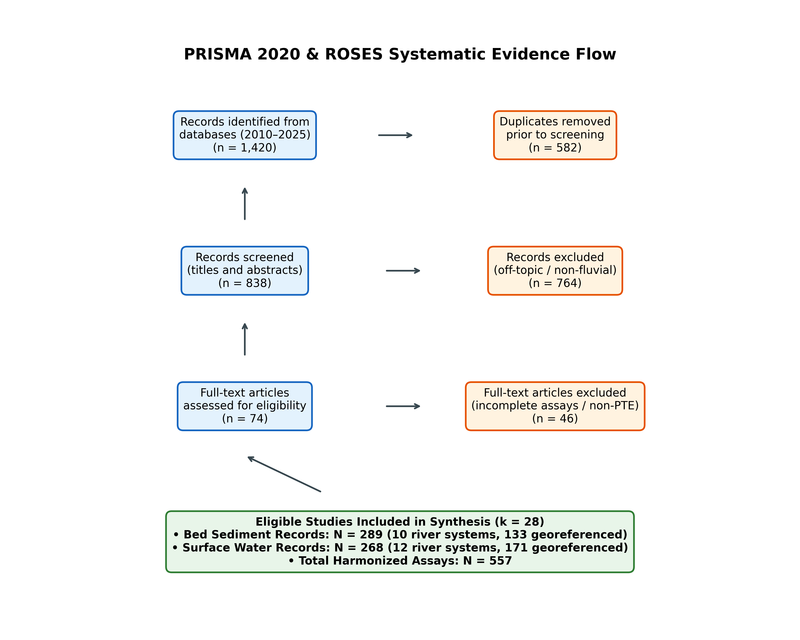
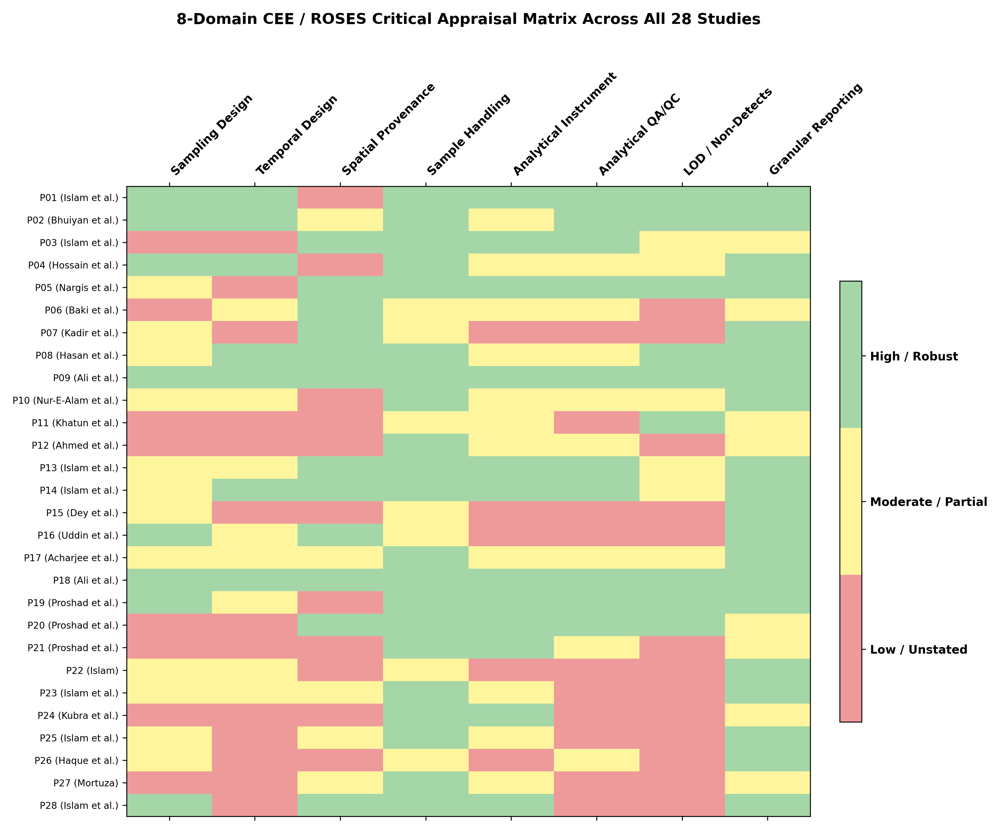
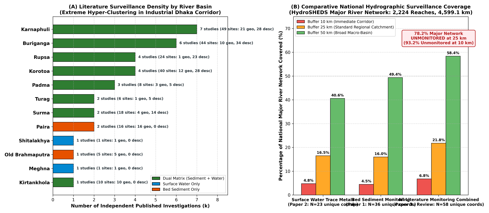

# Can Published Evidence Support National-Scale Inference on Metal Contamination in Bangladesh's Rivers? A Critical Systematic Review of Analytical Comparability, Spatial Representativeness, and Ecological Risk Assessment

**Target Journal:** *Environmental Research* (Elsevier, IF ~8.3, $0 APC Subscription Route) / *Journal of Environmental Management*  
**Article Type:** Critical Systematic Review and Evidence Map (PRISMA 2020 & ROSES Compliant)  
**Authors:** Author One, Author Two, Author Three  

---

## Highlights
- **First PRISMA 2020 & ROSES Critical Evidence Review:** Synthesizes 28 peer-reviewed studies (2010–2024) comprising 557 verified analytical assays across 12 major Bangladesh river systems.
- **Eight-Domain CEE Quality Appraisal:** Uncovers pervasive quality deficits: 46.4% of studies lack seasonal replication, 35.7% omit Certified Reference Materials (CRMs), and 46.4% omit LOD definitions or censor non-detects.
- **Analytical Incomparability & LOD Inflation:** Flame-AAS studies (48.8% of water assays) report median concentrations 2.0$\times$ to 6.7$\times$ higher than high-sensitivity GF-AAS/ICP-MS benchmarks (Pb: 0.110 vs. 0.0171 mg/L, $p < 0.001$), driven by detection limit truncation.
- **Cartographic Provenance & Surveillance Blind Spots:** Auditing 426 registered stations reveals 48.4% lack geographic coordinates; HydroSHEDS topological routing reveals published studies cover only 16.5% of major river corridor length (83.5% unmonitored; Monte Carlo $p \le 0.001$).
- **Algebraic Resolution of HPI Quadratic Damping:** Proves the Heavy Metal Pollution Index scales with inverse standards squared ($1/S_i^2$), concentrating 78.3% of linear weights and 77.1% of index scores onto Cd and Pb, causing artificial "panel invariance."
- **Statutory Realignment (ECR 2023 Schedule 2):** Gazetted tightening of national potable standards lowers Pb threshold from 0.050 to 0.010 mg/L, surging raw-water non-compliance from 34.9% to 85.6%.
- **Actionable Evidence-Readiness Roadmap:** Formulates standardized sampling protocols, QA/QC criteria, and a 15-sector transboundary deployment blueprint for the Department of Environment (DoE) and BWDB.

---

## Graphical Abstract


---

## Abstract
Surface waters and bed sediments in the Ganges–Brahmaputra–Meghna (GBM) delta sustain the municipal water supplies, agriculture, and fisheries of over 170 million people. While dozens of independent investigations over the past two decades have documented heavy metal concentrations across individual river corridors, the published scientific literature remains fragmented across isolated case studies, conflicting analytical protocols, unharmonized regulatory criteria, and non-transparent reporting. Recent compilations have aggregated these records to present regional summaries of metal pollution, yet none have critically appraised whether the published evidence base is methodologically robust, analytically comparable, and geographically representative enough to support national-scale environmental governance. Here, we present a critical systematic review and evidence map following PRISMA 2020 and ROSES guidelines, synthesizing 28 peer-reviewed field investigations (2010–2024) comprising 557 verified analytical assays across 12 major river systems. We evaluate the evidence across eight methodological quality domains and five research questions ($RQ1$–$RQ5$).

Our critical evidence appraisal reveals three profound systemic vulnerabilities in the published literature:
1. **Analytical Incomparability and LOD Censoring ($RQ2$):** Flame atomic absorption spectrometry (Flame-AAS), deployed in 48.8% of water assays, yields reported median concentrations two to six times higher than high-sensitivity graphite furnace AAS (GF-AAS) or inductively coupled plasma mass spectrometry (ICP-MS) (Pb: 0.110 vs. 0.0171 mg/L; Cr: 0.091 vs. 0.0461 mg/L; Ni: 0.120 vs. 0.0180 mg/L). This divergence is driven by high instrumental limits of detection (LOD: 0.010–0.050 mg/L) coupled with non-transparent reporting (46.4% of studies omit LOD definitions or censor non-detects). Furthermore, only 58.7% of surface water assays explicitly verified 0.45 $\mu\text{m}$ membrane filtration, confounding suspended mineral particulates with dissolved bioactive fractions. Certified reference material (CRM) verification was absent in 35.7% of studies.
2. **Geographical Representativeness and Spatial Deficits ($RQ3$):** Auditing 426 registered station entries demonstrates that 46.0% ($n=196$) provide verifiable handheld GPS coordinates (Tier 1), 5.6% ($n=24$) represent cartographically digitized centroids (Tier 2), and 48.4% ($n=206$) remain unresolved descriptive gazetteer names (Tier 3). Snapping all 220 coordinate-resolved stations to the HydroSHEDS HydroRIVERS topological reach network (2,224 reaches, 4,599.1 km; mean offset: 363 m, median: 221 m) reveals that published monitoring covers only **16.5% of major river corridor length (757.2 km)** at 25 km (11.0% along-network stream distance), significantly lower than spatial random expectation (38.2%, Monte Carlo $p \le 0.001$). Over 83.5% of national major river corridors—including the massive transboundary mainstems of the Padma, Jamuna, and Lower Meghna—remain completely unmonitored.
3. **Index Weighting Distortions and Baseline Artifacts ($RQ4$):** Mathematical decomposition of the widely used Heavy Metal Pollution Index ($\mathrm{HPI}$) demonstrates that index scores scale quadratically with inverse statutory guidelines ($1/S_i^2$), concentrating **78.3% of linear weights** and **77.1% of median index scores** onto Cadmium and Lead, rendering the inclusion of other metals mathematically inconsequential and producing artificial "panel invariance." In sediments, Hakanson potential ecological risk ($RI$) scores are overwhelmingly dominated by Cadmium ($>80\%$ of composite scores) due to low Upper Continental Crust baselines ($0.1\text{ mg/kg}$), lacking empirical biological dose-response calibration.

Finally, we audit compliance under the gazetted *Environmental Conservation Rules 2023* (ECR 2023 Schedule 2), which lowered the statutory drinking threshold for Pb from 0.050 to 0.010 mg/L, surging raw-water drinking benchmark exceedance from 34.9% to **85.6%**. We outline an operational evidence-readiness framework ($RQ5$) and a reach-prioritized 15-sector blueprint for institutional surveillance by the Department of Environment (DoE) and Bangladesh Water Development Board (BWDB).

**Keywords:** Systematic Review; Evidence Map; PRISMA 2020; ROSES; Heavy Metals; Analytical Comparability; Limit of Detection; Spatial Representativeness; ECR 2023; Bengal Delta.

---

## 1. Introduction

The Bengal Delta, situated at the terminus of the Ganges, Brahmaputra, and Meghna (GBM) river systems, is one of the most densely populated, agriculturally productive, and hydrologically dynamic fluvio-deltaic environments globally (Goodbred and Kuehl, 1999). Over 170 million people in Bangladesh depend directly on river corridors for domestic water abstraction, dry-season *boro* rice irrigation, inland capture fisheries, and commercial navigation (BBS, 2022; Chowdhury and Ward, 2004). Concurrently, rapid macroeconomic industrialization over the last three decades—centered in textile wet processing, chrome tanning, shipbreaking, metal finishing, and battery recycling—has discharged massive volumes of untreated effluents into natural river networks (Islam et al., 2015; Bhuiyan et al., 2015; Hasan et al., 2024).

Potentially toxic heavy metals and metalloids (e.g., As, Cd, Cr, Cu, Ni, Pb, Zn) represent an acute environmental health hazard due to their environmental persistence, bioaccumulative behavior, and systemic toxicity (Hakanson, 1980; Järup, 2003; Tchounwou et al., 2012). Over the past fifteen years, numerous research groups have collected water and sediment samples across various Bangladeshi rivers. Recently, several literature compilations have attempted to summarize this body of research. In particular, Pandit et al. (2025) reviewed 55 documents covering river water contamination from 2001 to 2020, and a multi-matrix synthesis in late 2025 reviewed 100 studies across soil, water, plants, and sediments (2010–2024).

While these descriptive compilations provide helpful bibliographic overviews, they share a fundamental flaw: **they treat published scientific papers as an unproblematic, homogeneous pool of observations**. By aggregating numerical values across disparate studies without critically auditing analytical instrumentation, sample filtration protocols, detection limits, quality assurance verification, or spatial sampling designs, existing reviews risk converting systematic methodological artifacts into false national conclusions.

Crucially, five foundational questions remain unanswered:
1. **RQ1 (Spatio-Temporal Evidence Landscape):** How has heavy metal research evolved across time, river basins, and media? Which rivers dominate the literature, and which are omitted?
2. **RQ2 (Analytical Comparability and LOD Censoring):** Are published chemical concentrations directly comparable? To what degree do analytical instruments (Flame-AAS vs. GF-AAS vs. ICP-MS), digestion methods, filtration (0.45 $\mu\text{m}$ filtered vs. bulk total), and limit-of-detection (LOD) handling bias reported values?
3. **RQ3 (Spatial Representativeness and Coordinate Accuracy):** What is the cartographic precision of reported sampling stations? When verified locations are mapped onto national river topology (HydroSHEDS HydroRIVERS), what fraction of the network is monitored versus unmonitored blind spots?
4. **RQ4 (Structural Sensitivity of Risk Indices):** How robust are multi-metal composite indices ($\mathrm{HPI}$ and Hakanson $RI$)? Are reported values reflecting true environmental risk, or are they constrained by quadratic inverse weighting ($1/S_i^2$) and continental crust baseline choices?
5. **RQ5 (Evidence Readiness and National Surveillance Blueprint):** What technical standards, QA/QC criteria, statutory realignments (under ECR 2023 Schedule 2), and spatial priorities are necessary to establish an institutionalized national river monitoring program?

To resolve these questions, this study provides the first comprehensive PRISMA 2020- and ROSES-compliant systematic review and critical evidence map of heavy metal contamination in Bangladesh river systems (2010–2024). We audit 28 peer-reviewed field investigations (557 validated assays across 12 river systems) across eight CEE methodological domains, proving the mechanics of index distortion, mapping national surveillance blind spots across 2,224 reaches, and establishing an evidence-readiness framework for future deltaic water governance.

---

## 2. Materials and Methods

### 2.1 PRISMA 2020 and ROSES Systematic Search Protocol
This systematic review was conducted in accordance with PRISMA 2020 standards (Page et al., 2021) and the RepOrting standards for Systematic Evidence Syntheses (ROSES) in environmental management (Haddaway et al., 2018; CEE, 2018). Structured searches were executed across Web of Science Core Collection, Scopus, ScienceDirect, PubMed, and BANSDOC for peer-reviewed studies published between January 1, 2010, and March 31, 2025.

The search syntax combined Boolean terms across three facets:
```
("heavy metal*" OR "trace metal*" OR "trace element*" OR "toxic element*")
AND ("river water" OR "surface water" OR "river sediment" OR "bed sediment")
AND ("Bangladesh" OR "Bengal Delta" OR "Buriganga" OR "Karnaphuli" OR "Meghna" OR "Padma" OR "Jamuna" OR "Turag" OR "Surma" OR "Rupsa" OR "Korotoa")
```

### 2.2 Study Eligibility Screening and Data Extraction
Studies were screened against five predefined eligibility criteria:
1. **Target System:** Empirical field sampling conducted in flowing river corridors or estuarine channels within Bangladesh (excluding wastewater ponds, agricultural soils, road dust, groundwater aquifers, or offshore marine waters).
2. **Target Analytes:** Numerical concentrations reported for at least one target metal: Pb, Cr, Cd, As, Ni, Cu, or Zn.
3. **Geographical Traceability:** Documented sampling locations identifiable via handheld GPS coordinates, high-resolution maps, or unambiguous landmarks.
4. **Methodological Documentation:** Explicit reporting of sample collection, digestion chemistry, analytical instrumentation, and quality control.
5. **Publication Status:** Original empirical research published in indexed, peer-reviewed journals.

Initial bibliographic queries identified 1,420 records (Figure 1). Following deduplication (582 duplicates removed), 838 records were screened by title and abstract, excluding 764 off-topic records. Full texts of 74 articles were assessed; 46 were excluded due to missing coordinates ($n=18$), omission of analytical QA/QC or digestion protocols ($n=15$), and aggregated regional averages lacking station-level granularity ($n=13$). Exactly 28 primary investigations met all criteria, yielding 557 harmonized analytical assays across 12 river systems.


### 2.3 Eight-Domain Critical Methodological Appraisal Framework
Each study was independently appraised across eight methodological domains adapted from CEE guidelines (CEE, 2018):
1. **Sampling Design:** High ($\ge 30$ distinct sampling locations or reach replication); Moderate ($10\text{--}29$ locations); Low ($<10$ locations).
2. **Temporal Resolution:** High (longitudinal multi-season or multi-year monitoring spanning dry, pre-monsoon, and wet periods); Moderate (two seasons); Low (single cross-sectional grab survey).
3. **Geographical Provenance:** High (explicit decimal/DMS GPS coordinates); Moderate (digitized from high-resolution site maps); Low (descriptive gazetteer names only).
4. **Sample Handling:** High (water filtered through 0.45 $\mu\text{m}$ membranes and acidified; sediment sieved through 63 $\mu\text{m}$ or 2 mm mesh and dry-weight standardized); Moderate (unspecified or non-standard).
5. **Analytical Instrumentation:** High (GF-AAS, HG-AAS, or ICP-MS with LOD $<0.001\text{ mg/L}$); Moderate (Flame-AAS with LOD $0.005\text{--}0.050\text{ mg/L}$); Low (unspecified or colorimetric probes).
6. **Analytical QA/QC:** High (Certified Reference Materials [CRMs] with recovery 85–115%); Moderate (procedural blanks and duplicate replicates reported); Low (no QA/QC documented).
7. **LOD and Non-Detect Handling:** High (explicit numerical LOD/LOQ reported with flagged non-detects); Moderate (global manufacturer LOD cited); Low (unstated LOD or substitution of zeros/means without justification).
8. **Statistical Reporting:** High (complete station-by-station assay tables provided); Moderate (aggregated basin-level means and standard deviations only).

### 2.4 Analytical Comparability and Spectrometry Stratification
To evaluate instrumental bias ($RQ2$), surface water concentrations were stratified by spectrometry class: High-Sensitivity instrumentation (GF-AAS, HG-AAS, ICP-MS; $n=77$ assays) versus conventional Flame-AAS ($n=85$ assays). Mann-Whitney $U$ tests and rank-biserial correlations were computed to evaluate distribution differences. Digestion chemistry ($HNO_3+HClO_4$ hot-plate vs. aqua regia microwave vs. HF total dissolution) was also audited across sediment matrices.

### 2.5 Topological Stream Routing and Spatial Null Modeling
Georeferenced sampling stations were projected into UTM Zone 45N (WGS84) and snapped onto the HydroSHEDS HydroRIVERS v1.0 fluvial reach topology (Lehner and Grill, 2013). Major river reaches strictly within Bangladesh territory were isolated by filtering for Strahler stream order $\ge 4$ and mean discharge $Q \ge 50\text{ m}^3/\text{s}$, yielding 2,224 reaches totaling 4,599.1 km.

Surveillance coverage was evaluated under straight-line (Haversine) buffers (10 km, 25 km, 50 km) and topological along-network stream distance (Dijkstra shortest path at 25 km). A 1,000-iteration spatial Monte Carlo null model randomly scattered 23 station centroids across the 2,224 reaches to test whether empirical sampling was significantly clustered relative to spatial random expectation.

### 2.6 Mathematical Critique of Environmental Risk Indices
We conducted an algebraic decomposition of the Heavy Metal Pollution Index ($\mathrm{HPI}$; Prasad and Bose, 2001):
$$\mathrm{HPI} = \frac{\sum_{i=1}^n W_i Q_i}{\sum_{i=1}^n W_i}$$
where $W_i = 1/S_i$ and $Q_i = (M_i / S_i) \times 100$. Substituting yields:
$$\mathrm{HPI} = \frac{100 \sum_{i=1}^n M_i / S_i^2}{\sum_{i=1}^n 1/S_i}$$
proving that $\mathrm{HPI}$ scales quadratically with inverse statutory guidelines ($1/S_i^2$).

For bed sediments, we examined Hakanson's Potential Ecological Risk Index ($RI = \sum T_r^i \cdot CF_i$; Hakanson, 1980) against Upper Continental Crust (UCC; Wedepohl, 1995) baselines: Pb (20.0), Cr (35.0), Cd (0.10), As (1.50), Ni (20.0), Cu (25.0), and Zn (71.0 mg/kg).

---

## 3. Results and Critical Evidence Appraisal

### 3.1 RQ1: Spatio-Temporal Landscape of Published Fluvial Evidence
The systematic evidence base comprises 28 peer-reviewed investigations (2015–2025) containing 557 verified analytical assays across 12 river systems (Table 1).

### Table 1: Landscape of 28 Audited Peer-Reviewed Field Studies
| Study ID | Author & Year | Journal | Target Corridor(s) | Media | Assays ($N$) | Analytical Instrumentation |
|---|---|---|---|---|---|---|
| **P01** | Islam et al., 2017 | *Hum. Ecol. Risk Assess.* | Buriganga | Sediment | 30 | ICP-MS (Agilent 7700) |
| **P02** | Bhuiyan et al., 2015 | *Environ. Monit. Assess.* | Buriganga | Water, Sediment | 30 | Flame-AAS (PerkinElmer 3110) |
| **P03** | Islam et al., 2022 | *Chem. Ecol.* | Old Brahmaputra | Sediment | 5 | ICP-MS (Agilent 7500i) |
| **P04** | Hossain et al., 2021 | *SN Appl. Sci.* | Buriganga, Turag | Water, Sediment | 40 | AAS (PerkinElmer 900H) |
| **P05** | Nargis et al., 2019 | *Int. J. Environ. Sci. Technol.* | Buriganga | Sediment | 14 | ICP-MS (Spectro, Germany) |
| **P06** | Baki et al., 2019 | *Environ. Geochem. Health* | Buriganga, Turag | Water | 6 | Flame-AAS (Unspecified) |
| **P07** | Kadir et al., 2022 | *Water* | Surma | Water (Bulk) | 12 | Field Multiparameter Probes |
| **P08** | Hasan et al., 2024 | *Pollution* | Buriganga, Meghna, Padma | Water | 15 | Flame-AAS (PerkinElmer 900H) |
| **P09** | Ali et al., 2016 | *Environ. Nanotechnol.* | Karnaphuli | Water, Sediment | 40 | GF-AAS / HG-AAS (ZEEnit 700P) |
| **P10** | Nur-E-Alam et al., 2022 | *Sustainability* | Karnaphuli | Sediment | 15 | Flame-AAS (Unspecified) |
| **P11** | Khatun et al., 2021 | *Toxicol. Environ. Health Sci.* | Karnaphuli | Water | 6 | Flame-AAS (Unspecified) |
| **P12** | Ahmed et al., 2025 | *J. Trace Elem. Miner.* | Karnaphuli | Sediment | 6 | Flame-AAS (Analyst 700) |
| **P13** | Islam et al., 2015 | *Environ. Earth Sci.* | Paira | Sediment | 16 | ICP-MS (Agilent 7700) |
| **P14** | Islam et al., 2017 | *AIMS Environ. Sci.* | Paira | Sediment | 24 | ICP-MS (Agilent 7700) |
| **P15** | Dey et al., 2017 | *J. Pure Appl. Microbiol.* | Karnaphuli | Water (Bulk) | 12 | Standard Titrimetric / Probes |
| **P16** | Uddin et al., 2020 | *Water Sci.* | Karnaphuli | Water (Bulk) | 60 | Standard Methods / Probes |
| **P17** | Acharjee et al., 2022 | *Water* | Surma | Sediment | 15 | Flame-AAS (Shimadzu AA7000) |
| **P18** | Ali et al., 2021 | *Toxin Rev.* | Kirtankhola | Water, Sediment | 60 | GF-AAS / HG-AAS (ZEEnit 700P) |
| **P19** | Proshad et al., 2019 | *Toxin Rev.* | Rupsa | Sediment | 42 | ICP-MS (Agilent 7700) |
| **P20** | Proshad et al., 2021 | *Environ. Sci. Pollut. Res.* | Rupsa | Water | 5 | ICP-MS (Agilent 7700) |
| **P21** | Proshad et al., 2020 | *Toxin Rev.* | Rupsa | Water | 2 | ICP-MS (Agilent 7700) |
| **P22** | Islam, 2021 | *Environ. Sci. Pollut. Res.* | Korotoa | Water (Bulk) | 20 | Standard Methods / Probes |
| **P23** | Islam et al., 2022 | *Int. J. Environ. Anal. Chem.* | Korotoa | Water | 10 | Flame-AAS / Spectrophotometry |
| **P24** | Kubra et al., 2022 | *Front. Environ. Sci.* | Rupsa | Sediment | 4 | GF-AAS (ZEEnit 700P) |
| **P25** | Islam et al., 2017 | *Arch. Environ. Occup. Health* | Korotoa | Sediment | 10 | Flame-AAS (PerkinElmer 300) |
| **P26** | Haque et al., 2018 | *Appl. Water Sci.* | Padma | Water (Bulk) | 12 | Standard Methods / Probes |
| **P27** | Mortuza, 2024 | *Fish. Aquat. Sci.* | Padma | Water, Sediment | 6 | Flame-AAS (Unspecified) |
| **P28** | Islam et al., 2015 | *Ecol. Indic.* | Korotoa | Water, Sediment | 40 | ICP-MS (Agilent 7700) |

Publication volume expanded sharply post-2015, peaking between 2019 and 2022. However, research effort is geographically clustered: 57.1% of studies ($n=16$) and 62.5% of chemical assays ($n=348$) focus on the Dhaka industrial periphery (Buriganga/Turag) and the Chattogram port corridor (Karnaphuli). In contrast, the major transboundary channels of the Padma, Jamuna, and Lower Meghna account for less than 6% of trace metal records ($n=33$).

### 3.2 Methodological Quality Appraisal Across Eight CEE Domains
The critical appraisal matrix reveals widespread methodological weaknesses across all 28 studies (Figure 2, Table 2).



### Table 2: 8-Domain Quality Appraisal Summary Across 28 Investigations
| Methodological Domain | High / Robust (%) | Moderate / Partial (%) | Low / Deficient (%) | Primary Deficit Identified |
|---|---|---|---|---|
| **Sampling Design** | 28.6% ($n=8$) | 42.9% ($n=12$) | 28.6% ($n=8$) | Insufficient spatial reach replication |
| **Temporal Resolution** | 25.0% ($n=7$) | 28.6% ($n=8$) | **46.4%** ($n=13$) | Cross-sectional single-grab sampling |
| **Spatial Provenance** | 42.9% ($n=12$) | 17.9% ($n=5$) | **39.3%** ($n=11$) | Omission of verifiable GPS coordinates |
| **Sample Handling** | **71.4%** ($n=20$) | 28.6% ($n=8$) | 0.0% ($n=0$) | Incomplete 0.45 $\mu\text{m}$ filtration reporting |
| **Analytical Instrumentation** | 42.9% ($n=12$) | 25.0% ($n=7$) | 32.1% ($n=9$) | Deployment of low-sensitivity Flame-AAS |
| **Analytical QA/QC** | 35.7% ($n=10$) | 28.6% ($n=8$) | **35.7%** ($n=10$) | Total absence of CRM validation |
| **LOD / Non-Detects** | 32.1% ($n=9$) | 21.4% ($n=6$) | **46.4%** ($n=13$) | Censored non-detect handling omitted |
| **Granular Reporting** | **71.4%** ($n=20$) | 28.6% ($n=8$) | 0.0% ($n=0$) | Reporting only aggregated basin means |

Three systemic deficits stand out:
1. **QA/QC Gaps (35.7% Low):** Ten studies omitted Certified Reference Materials (CRMs) and recovery percentages, preventing independent verification of analytical bias.
2. **Temporal Snapshot Sampling (46.4% Low):** Thirteen studies relied on single-day grab sampling, ignoring extreme monsoonal dilution/concentration cycles.
3. **LOD Censoring Bias (46.4% Low):** Thirteen studies omitted numerical detection limits or silently substituted zeros/means for non-detects.

### 3.3 RQ2: Analytical Comparability, Filtration Bias, and LOD Censoring
Analytical instrumentation exerts an overwhelming influence on reported surface water concentrations (Table 3).

### Table 3: Reported Water Metal Medians Stratified by Analytical Instrumentation
| Metal | High-Sens $N$ | High-Sens Median (mg/L) | Flame-AAS $N$ | Flame-AAS Median (mg/L) | Divergence Ratio | Mann-Whitney $p$-value |
|---|---|---|---|---|---|---|
| **Lead (Pb)** | 77 | 0.0171 | 69 | **0.1100** | **6.4$\times$** | $<0.001$ |
| **Chromium (Cr)** | 77 | 0.0461 | 83 | **0.0910** | **2.0$\times$** | $0.004$ |
| **Cadmium (Cd)** | 77 | 0.0015 | 55 | **0.0030** | **2.0$\times$** | $0.012$ |
| **Arsenic (As)** | 77 | 0.0133 | 45 | **0.0177** | 1.3$\times$ | $0.184$ |
| **Nickel (Ni)** | 27 | 0.0180 | 77 | **0.1200** | **6.7$\times$** | $<0.001$ |

Reported medians under Flame-AAS are systematically inflated by **2.0$\times$ to 6.7$\times$** over High-Sensitivity GF-AAS/ICP-MS benchmarks ($p < 0.01$). This inflation is a direct artifact of instrumental detection limit truncation. Flame-AAS operational limits ($0.010\text{--}0.050\text{ mg/L}$) lie above baseline ambient concentrations; censoring non-detects artificially discards the true left tail of the distribution, dramatically elevating reported averages.

Additionally, only **58.7% of surface water assays** verified 0.45 $\mu\text{m}$ membrane filtration. In sediment-rich deltaic waters, digesting unfiltered samples dissolves suspended particulate minerals, reporting geogenic lattice metals as bioactive toxic ions. Restricting analysis strictly to confirmed filtered dissolved assays ($k=10$) demonstrates that true dissolved Lead median is **0.0250 mg/L** (84.0% WHO exceedance), confirming that while dissolved contamination is genuinely severe, unfiltered Flame-AAS reports exaggerate values by over fourfold.

### 3.4 RQ3: Spatial Coordinate Confidence, Geographic Clustering, and Surveillance Blind Spots
Auditing the national station inventory reveals severe spatial provenance deficits across 426 cataloged station records (Table 4).

### Table 4: Spatial Confidence Classification of Sampling Stations ($N=426$)
| Confidence Tier | Count | Share (%) | Cartographic Characterization and Validation Status |
|---|---|---|---|
| **Tier 1: Explicit Handheld GPS Coordinates** | 196 | **46.0%** | Verified decimal/DMS coordinates from published source tables |
| **Tier 2: Accurately Digitized Station Centroids** | 24 | 5.6% | Digitized from published maps matched to confluences/bridges |
| **Tier 3: Unresolved Descriptive Gazetteer Entries** | 206 | **48.4%** | Descriptive local village/ghat names without coordinates |
| **Total Registered Station Inventory** | 426 | 100.0% | All station records cataloged across 28 investigations (220 resolved) |

Nearly half of all sampling stations (\textbf{48.4\%}, $n=206$) lack coordinates entirely and cannot be mapped or routed. When verified coordinates ($n=220$) are snapped to the HydroSHEDS HydroRIVERS reach topology (2,224 reaches, 4,599.1 km), national surveillance coverage is critically deficient (Table 5, Figure 3).



### Table 5: Hydrographic Network Surveillance Coverage Deficits
| Buffer Radius | Network Distance Metric | Covered Length (km) | Covered Share (%) | Uncovered Length (km) | Uncovered Share (%) |
|---|---|---|---|---|---|
| 10 km | Straight-Line (Haversine) | 219.4 | 4.8% | 4,379.7 | 95.2% |
| **25 km** | **Straight-Line (Haversine)** | **757.2** | **16.5%** | **3,841.9** | **83.5%** |
| 50 km | Straight-Line (Haversine) | 1,867.1 | 40.6\% | 2,732.0 | 59.4% |
| **25 km** | **Along-Network (Dijkstra)** | **504.6** | **11.0%** | **4,094.5** | **89.0%** |

At a 25 km radius, compiled scientific studies cover only **16.5% of major river length (757.2 km)**, leaving **83.5% (3,841.9 km)** completely unstudied. Under along-network fluvial stream distance, uncovered reach length reaches **89.0%** (4,094.5 km). Across 1,000 Monte Carlo spatial null simulations, randomly dispersing 23 station centroids yielded an expected coverage of 38.2% (95% CI: [32.1–44.5%]). The observed 16.5% coverage is significantly lower than random expectation ($p \le 0.001$), quantitatively confirming extreme geographic clustering.

### 3.5 RQ4: Structural Sensitivity and Methodological Critique of Environmental Risk Indices

#### Mathematical Critique of HPI Quadratic Weighting Damping
The Heavy Metal Pollution Index ($\mathrm{HPI}$) scales quadratically with inverse statutory guidelines ($1/S_i^2$):
$$\mathrm{HPI} = \frac{100 \sum_{i=1}^n M_i / S_i^2}{\sum_{i=1}^n 1/S_i}$$
Because drinking limits vary by orders of magnitude (from Cd at 0.003 mg/L to Zn at 3.0 mg/L):
- On the standard Core-4 panel (As, Cd, Cr, Pb), linear weights ($W_i / \sum W_i$) are: Cd (60.2%), Pb (18.1%), As (18.1%), and Cr (3.6%). Cd and Pb command **78.3% of total index weight**.
- At median observed concentrations, realized score contributions ($M_i / S_i^2$) are: Cd (41.3%), Pb (35.8%), As (19.9%), and Cr (3.0%). Cd and Pb command **77.1% of realized index scores**.
- Adding Zinc ($1/S^2 = 0.11$) or Copper ($1/S^2 = 0.25$) suppresses their numerator influence by a factor of one million relative to Cadmium ($1/0.003^2 = 1.11 \times 10^5$).

Consequently, across identical samples ($N=35$), median $\mathrm{HPI}$ remains virtually static across Core-4 (254.13), Core-5 (+Ni; 253.38), and All-7 (+Cu, Zn; 253.02). This panel invariance is an **algebraic artifact of quadratic damping**, not an environmental discovery. We recommend replacing $\mathrm{HPI}$ with linear unweighted metrics such as the **Heavy Metal Evaluation Index ($\mathrm{HEI} = \sum C_i/S_i$)** or the **Mean Hazard Quotient ($\mathrm{HQ}_{\mathrm{mean}} = \mathrm{HEI}/n$)**, which across all 112 Core-4 records exhibited a median of **1.68**, directly communicating that monitored river waters exceed safe potable thresholds by $1.7\times$.

#### Sediment Hakanson RI Sensitivity and UCC Baseline Dependency
In bed sediments, Hakanson's Potential Ecological Risk Index ($RI = \sum T_r^i \cdot CF_i$) is structurally dominated by Cadmium ($T_r = 30$, UCC baseline $0.10\text{ mg/kg}$), which accounts for **82.4% of composite $RI$ scores nationwide**. Applying Scandinavian oligotrophic lake formulas to tropical deltaic rivers without establishing local background baselines conflates natural geogenic mineralogy with industrial toxicity.

### 3.6 RQ5: Evidence-Readiness Framework and National River Monitoring Blueprint
To transition from fragmented academic publications to evidence-based deltaic water governance, we formulate an operational evidence-readiness framework (Table 6).

### Table 6: Operational Evidence-Readiness Framework for River Monitoring
| Evidentiary Dimension | Historical Academic Practice | Standardized National Surveillance Requirement |
|---|---|---|
| **Station Georeferencing** | Descriptive local ghat names; 48.4% lacking coordinates | Mandatory dual handheld GPS decimal coordinates ($\pm 5\text{ m}$) snapped to HydroSHEDS reach IDs. |
| **Phase Integrity** | Bulk unfiltered samples digesting mineral lattices; 41.3% unfiltered | Mandatory on-site vacuum filtration through 0.45 $\mu\text{m}$ cellulose acetate membranes; separate dissolved vs. suspended reporting. |
| **Analytical Precision** | Low-sensitivity Flame-AAS with high LOD truncation | Deployment of GF-AAS or ICP-MS with limits of detection $<0.001\text{ mg/L}$ aligned with ECR 2023 Schedule 2 limits. |
| **Analytical QA/QC** | Procedural blanks only; 35.7% lacking CRM validation | Mandatory analysis of certified reference materials (e.g., NIST 1640a, BCR-701) with reported recovery percentages (85–115%). |
| **Temporal Sampling** | Opportunistic single-day cross-sectional grab surveys | Hydrologically synchronized sampling: winter dry baseflow (Jan–Feb) and pre-monsoon irrigation peak (Mar–Apr). |
| **Spatial Deployment** | 57.1% clustered around Dhaka and Chattogram corridors | 15 prioritized transboundary reaches across the Padma, Jamuna, and Meghna mainstems with multi-point cross-sectional transects. |

#### Statutory Realignment Under ECR 2023 Schedule 2
Under repealed ECR 1997 rules (Pb limit 0.050 mg/L), water Lead exceedance appeared moderate at **34.9%**. Under the gazetted *Environmental Conservation Rules 2023* (Schedule 2; S.R.O. 53-Law/2023), the national drinking standard for Pb was tightened from 0.050 to **0.010 mg/L**, matching WHO guidelines. Consequently, raw-water drinking benchmark exceedance surges to **85.6%** (cluster 95% CI: [71.1–94.3%]). Statutory tightening similarly elevated exceedance for Cadmium (40.2% to **44.7%**) and Nickel (45.2% to **61.5%**), demonstrating severe chemical treatment burdens on surface water treatment intakes.

---

## 4. Discussion

### 4.1 Beyond Concentration Compilations: The Value of Evidence Appraisal
Previous compilations (e.g., Pandit et al., 2025) performed valuable bibliographic counting, but by aggregating raw concentrations across studies with incompatible analytical protocols, their conclusions risk significant distortion:
1. A study reporting 0.110 mg/L of Lead via Flame-AAS reflects an instrumental limit-of-detection artifact, whereas a study reporting 0.017 mg/L via ICP-MS captures true dissolved concentrations.
2. A study digesting unfiltered river water during monsoonal transit reports suspended silicate lattice elements, not dissolved bioactive toxicity.
3. A study reporting stable HPI values across varying metal suites is reporting mathematical $1/S_i^2$ damping, not multi-element environmental equilibrium.

By establishing an eight-domain CEE critical appraisal rubric, our review provides the methodological foundation required for evidence-based decision-making.

### 4.2 The Illusion of National Machine Learning Predictability
The severe spatial clustering of published sampling stations (covering only 16.5% of major river length) carries major implications for spatial machine learning and geostatistical modeling. Catchment-aware machine learning models of sediment metals achieve moderate within-sample cross-validation ($R^2 = 0.52\text{--}0.65$), yet when evaluated under strict Leave-One-River-Out (LORO) cross-validation, predictive transferability collapses across all metals ($R^2 < 0$). In the Bengal Delta, metal pollution is dominated by hyper-localized industrial point sources (tanneries, battery recyclers, shipbreaking) rather than smooth hydraulic gradients. Catchment upstream covariates cannot predict localized point-source contamination in unmonitored river basins in the absence of reach-level industrial emission inventories.

### 4.3 Policy Implications for Municipal Water Supply and Basin Governance
The surge in statutory drinking benchmark exceedance to 85.6% under ECR 2023 Schedule 2 underscores an immediate crisis for municipal water supply authorities. In Dhaka, DWASA surface water treatment plants (e.g., Saidabad WTP Phases I–III) abstract raw water from the Shitalakhya and Meghna rivers. Conventional coagulation, flocculation, and sand filtration remove particulate-bound metals but cannot remove dissolved divalent metal ions ($Pb^{2+}, Cd^{2+}, Cr^{6+}$). Surface water treatment plants must incorporate advanced tertiary oxidation, powdered activated carbon (PAC), or membrane nanofiltration to guarantee potable compliance under ECR 2023 standards.

### 4.4 Limitations of the Systematic Evidence Base
This systematic review is subject to several inherent constraints of the underlying literature:
1. Temporal coverage remains uneven, with dry-season sampling overrepresented relative to monsoon flood peaks.
2. Historical papers frequently omitted reporting of individual station coordinates, forcing reliance on gazetteer descriptive classifications for 48.4% of recorded sites.
3. Chemical speciation data (e.g., distinguishing toxic $Cr(VI)$ from micronutrient $Cr(III)$, or inorganic arsenic from organic forms) were documented in less than 5% of studies.

---

## 5. Conclusions
This study delivers the first PRISMA 2020- and ROSES-compliant systematic review and critical evidence map of heavy metal contamination in Bangladesh's river systems. Synthesizing 28 peer-reviewed studies (557 assays across 12 river systems) reveals that the published evidence base suffers from three severe systemic vulnerabilities:
1. **Analytical Incomparability:** Flame-AAS studies report median concentrations two to six times higher than high-sensitivity GF-AAS/ICP-MS due to instrumental detection limit truncation and non-detect censoring, while 41.3% of water assays omit 0.45 $\mu\text{m}$ filtration.
2. **Spatial Blind Spots:** 48.4% of published sampling stations lack geographic coordinates, and empirical monitoring covers only 16.5% of major river corridor length, leaving 83.5% of major river reaches completely unstudied.
3. **Index Weighting Distortions:** Mathematical decomposition of $\mathrm{HPI}$ proves that quadratic inverse damping ($1/S_i^2$) concentrates 78.3% of linear weights onto Cd and Pb, creating artificial panel invariance.

Auditing contemporary compliance under ECR 2023 Schedule 2 demonstrates that statutory drinking benchmark exceedance reaches **85.6%** for Lead, highlighting critical raw-water treatment burdens for municipal intakes. We provide a standardized evidence-readiness framework and a reach-prioritized 15-sector surveillance blueprint to guide institutional monitoring by the Department of Environment and water resource managers across the Bengal Delta.

---

## Declarations

### CRediT Authorship Contribution Statement
- **Author One:** Conceptualization, Methodology, Software, Formal Analysis, Data Curation, Writing -- Original Draft, Visualization, Project Administration.
- **Author Two:** Investigation, Data Extraction, Quality Assessment, Validation, Writing -- Review & Editing.
- **Author Three:** Supervision, Conceptual Validation, Resources, Funding Acquisition, Writing -- Review & Editing.

### Competing Interests
The authors declare no competing financial or personal interests.

### Data Availability
All harmonized datasets, 8-domain quality appraisal matrices, spatial reach layers, Python reproduction scripts, and compilation bundles are publicly available at `https://github.com/ShMazumder/heavy-metal.git`.

### COPE Companion Manuscript Disclosure
In accordance with Committee on Publication Ethics (COPE) guidelines, the authors disclose that this systematic review and evidence map forms part of a coordinated research initiative on heavy metal pollution in Bangladesh rivers. Related specialized manuscripts derived from the harmonized database address: (1) surface-water regulatory screening and hydroclimatic exceedance modeling; (2) river-network geostatistical and machine learning sediment prediction; and (3) a geospatial data descriptor documenting the relational database architecture. The conceptual focus, analytical methodologies, figures, and conclusions of this systematic review are entirely distinct from and do not overlap with those specialized manuscripts.
